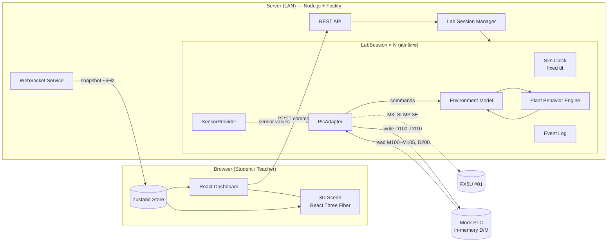
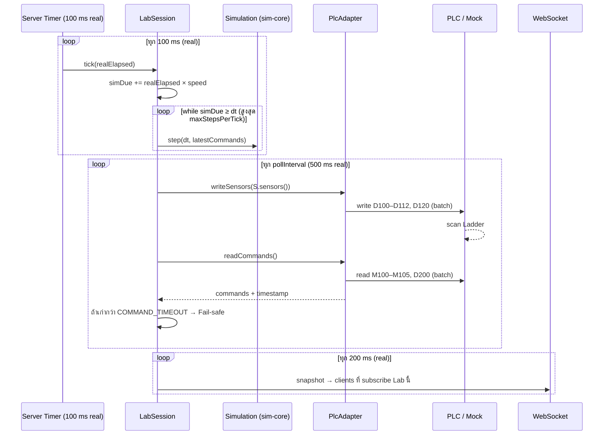

# Software Architecture

เกี่ยวข้อง: [SPEC.md](SPEC.md) · [DEVICE-MAP.md](DEVICE-MAP.md) · [PHASES.md](PHASES.md)

---

## 1. ภาพรวม



**หลักการสำคัญ**

1. **Simulation อยู่บน Server เท่านั้น** Browser มีหน้าที่แสดงผลและส่งคำสั่ง UI ส่วนผลลัพธ์จึงไม่ขึ้นกับ FPS
2. **`sim-core` เป็น Pure TypeScript** ไม่มี I/O และไม่มี `Date.now()` (เวลามาจากพารามิเตอร์) ทำให้ Deterministic และเทสต์ได้ง่าย
3. **Plant Calculation แยกจาก 3D โดยเด็ดขาด** Frontend รับ `PlantState` แล้วแปลงเป็น `PlantVisual` (droop, curl, color, scale) ผ่าน Pure Function ฝั่ง Web
4. **ทุกอย่างที่เปลี่ยนในอนาคตอยู่หลัง Interface** ได้แก่ `PlcAdapter` (Mock → SLMP), `SensorProvider` (Simulated → Real), `Persistence` (Memory → SQLite)

## 2. Repository Structure

```
Green_oak_plan/
├─ docs/                         Spec, Architecture, Device Map, Phases (Obsidian)
├─ packages/
│  ├─ shared/                    @gol/shared — ใช้ร่วม Server/Web
│  │  └─ src/
│  │     ├─ types.ts             SensorReadings, ActuatorCommands, PlantState, LabSnapshot
│  │     ├─ deviceMap.ts         Address + Scaling (single source of truth)
│  │     ├─ protocol.ts          WS/REST message schemas (zod)
│  │     └─ units.ts
│  └─ sim-core/                  @gol/sim-core — Pure simulation, no I/O
│     └─ src/
│        ├─ clock.ts             SimClock: speed, pause, accumulator, fixed dt
│        ├─ config/              defaultConfig.ts (พารามิเตอร์ + หน่วย + คำอธิบาย)
│        ├─ environment/         tank.ts, air.ts, light.ts, nutrient.ts, power.ts
│        ├─ plant/               plant.ts, water.ts, growth.ts, stress.ts (M2)
│        ├─ sensors.ts           State → SensorReadings (+ seeded noise)
│        ├─ simulation.ts        Simulation.step(dt, commands) — รวมทุก model
│        └─ rng.ts               Seeded PRNG
│     └─ test/                   Vitest unit tests (AC-01…AC-07)
├─ apps/
│  ├─ server/                    @gol/server — Fastify
│  │  └─ src/
│  │     ├─ index.ts             bootstrap, env
│  │     ├─ lab/                 LabSession.ts, LabManager.ts, EventLog.ts, History.ts
│  │     ├─ plc/
│  │     │  ├─ PlcAdapter.ts     interface + guards (write D sensors only)
│  │     │  ├─ MockPlcAdapter.ts in-memory device memory + auto program
│  │     │  ├─ mockPrograms.ts   ตัวอย่าง Logic แบบ Ladder (hysteresis)
│  │     │  └─ slmp/             (M3) SLMP 3E client
│  │     ├─ sensors/             SensorProvider.ts, SimulatedSensorProvider.ts
│  │     ├─ api/                 routes.ts (REST), ws.ts (WebSocket)
│  │     └─ persistence/         (M4/M5) SQLite
│  │  └─ test/                   integration tests (AC-08…AC-11)
│  └─ web/                       @gol/web — Vite + React
│     └─ src/
│        ├─ app/                 routes: /lab/:id (Student), /teacher (M4)
│        ├─ store/               labStore.ts (Zustand), wsClient.ts
│        ├─ dashboard/           Header, SensorPanel, ActuatorPanel, PlantDetail,
│        │                       Timeline, Charts, EventLog, SpeedControl
│        └─ scene/               Scene.tsx, Tank.tsx, Water.tsx, NetPots.tsx,
│                                Lettuce.tsx, Roots.tsx, Actuators/*, plantVisuals.ts
├─ .env.example
├─ package.json                  npm workspaces + scripts
└─ README.md                     ภาษาไทย (สมบูรณ์ใน P7)
```

## 3. Technology Choices

| ส่วน | เลือก | เหตุผล |
|---|---|---|
| Monorepo | **npm workspaces** | มากับ Node ไม่ต้องติดตั้งเพิ่ม เหมาะกับเครื่องห้องเรียน |
| Language | TypeScript (strict) | Type ร่วมกันระหว่าง Server/Web ผ่าน `@gol/shared` |
| Frontend | React 19, Vite, React Three Fiber 9, Drei 10, Tailwind CSS 4, Zustand 5, Recharts, Lucide React | ตาม Master Prompt (R3F 9 ต้องใช้คู่กับ React 19) |
| Backend | Fastify 5, @fastify/websocket, zod | เร็ว, Type-safe, `inject()` ทำ Integration Test ได้โดยไม่ต้องเปิดพอร์ต |
| Dev runner | `tsx` (server), Vite (web), `concurrently` | `npm run dev` คำสั่งเดียว |
| Test | **Vitest** | ใช้ได้ทั้ง sim-core, server และ web |
| Database | SQLite (`better-sqlite3`) — **เริ่ม M4/M5** | M1 ใช้ In-memory หลัง `Persistence` interface |

> เวอร์ชันจริงจะ Lock ใน `package-lock.json` ตอน P1 หากเวอร์ชันใดมีปัญหาบน Windows จะแจ้งก่อนเปลี่ยน

## 4. Runtime Loop (ต่อ 1 LabSession)



| Parameter | Default | Env |
|---|---|---|
| Fixed step `dt` | 1 s (sim) | — (`defaultConfig.ts`) |
| Server tick | 100 ms | `SIM_TICK_MS` |
| Max steps / tick | 5000 | — (ป้องกัน spiral of death) |
| PLC poll | 500 ms | `PLC_POLL_MS` |
| Command timeout | 3000 ms | `PLC_COMMAND_TIMEOUT_MS` |
| WS broadcast | 200 ms | `WS_BROADCAST_MS` |
| History sample | ทุก 10 นาทีจำลอง, เก็บ 14 วันจำลอง | — |

**Fail-safe state:** Fan OFF, Humidifier OFF, LED 0%, Refill OFF, Nutrient A/B OFF, **Air Pump ON**

## 5. Key Interfaces

```ts
// packages/shared/src/types.ts (ร่าง)
export interface ActuatorCommands {
  fan: boolean; humidifier: boolean; ledPct: number;       // 0–100
  refillPump: boolean; nutrientA: boolean; nutrientB: boolean; airPump: boolean;
}

export interface SensorReadings {
  airTempC: number; rhPct: number; ppfd: number; waterTempC: number;
  ph: number; ecMsCm: number; waterLevelPct: number; flowLpm: number;
  powerW: number; vpdKPa: number; dli: number;
}

// apps/server/src/plc/PlcAdapter.ts (ร่าง)
export interface PlcAdapter {
  readonly kind: 'mock' | 'slmp';
  connect(): Promise<void>;
  close(): Promise<void>;
  writeSensors(r: SensorReadings, sim: SimInfo): Promise<void>; // เขียน D100–D112, D120 เท่านั้น
  readCommands(): Promise<{ commands: ActuatorCommands; at: number }>;
  status(): PlcStatus;   // connected | connecting | offline | error, lastOkAt, errorCount, latencyMs
}

// apps/server/src/sensors/SensorProvider.ts (ร่าง)
export interface SensorProvider {
  readonly kind: 'simulated' | 'real';
  read(): SensorReadings;
}
```

**Write guard (FR-31):** `writeSensors` สร้าง Payload จาก `deviceMap.sensors` เท่านั้น และ Low-level writer ตรวจซ้ำว่า Device อยู่ใน Allowlist (D100–D112, D120) ถ้าไม่ใช่ให้ `throw` ส่วน M Device ไม่มี path เขียนเลย

**AI / RL hook (อนาคต):** `LabSession` มีเมธอด `observe(): LabSnapshot` และ `act(cmd: ActuatorCommands)` ซึ่งเป็นรูปแบบเดียวกับ PLC Adapter ทำให้ภายหลังเพิ่ม `AgentAdapter` ได้โดยไม่แก้ Simulation

## 6. API (M1)

**REST**

| Method | Path | ใช้ทำ |
|---|---|---|
| GET | `/api/health` | สถานะ Server |
| GET | `/api/labs` | รายการ Lab + สรุปสถานะ |
| GET | `/api/labs/:labId` | Snapshot ปัจจุบัน |
| GET | `/api/labs/:labId/history` | ข้อมูลย้อนหลังสำหรับกราฟ |
| GET | `/api/labs/:labId/events?limit=` | Event Log |
| GET | `/api/scenarios` | รายการ Scenario |
| POST | `/api/labs/:labId/commands` | ดูตารางคำสั่งด้านล่าง ตอบกลับเป็น Snapshot ใหม่ |

| Command (`type`) | Field | หมายเหตุ |
|---|---|---|
| `setSpeed` | `speed`: 1 / 60 / 360 | |
| `pause`, `resume` | — | |
| `reset` | — | เริ่มใหม่ ใช้ Scenario เดิมถ้ามี |
| `applyScenario` | `scenarioId` | Reset แล้วตั้ง Initial conditions + Disturbance |
| `clearScenario` | — | Reset แบบไม่มี Scenario |
| `setPlcMode` | `mode`: manual / auto / offline | Mock PLC เท่านั้น (409 ถ้าไม่ใช่ Mock) |
| `setManualBit` | `key`, `value` | เฉพาะ manual mode (409 ถ้าไม่ใช่) |
| `setManualLed` | `value` 0–100 | เฉพาะ manual mode |

**WebSocket** `/ws`
- Client → `{ type: "subscribe", labId }`
- Client → `{ type: "ping", t }`
- Server → `hello` (พร้อม `labIds`), `heartbeat`, `pong`, `{ type: "snapshot", labId, data: LabSnapshot }` (~5 Hz, ส่งทันทีตอน subscribe) และ `{ type: "event", labId, event }`

ทุกข้อความผ่าน zod validation ส่วน Auth/สิทธิ์ (Student เห็นเฉพาะ Lab ตัวเอง) เพิ่มใน M4

## 7. Simulation Model — M1 Baseline

> [!note] ทุกค่าใน § 7 อยู่ใน `sim-core/src/config/defaultConfig.ts` พร้อมหน่วยและคำอธิบาย
> ค่าเหล่านี้ตั้งขึ้นให้ **สมเหตุสมผลเชิงการสอน** และให้เห็นผลในเวลาเรียนเมื่อใช้ 360x ยังไม่ได้ปรับเทียบกับข้อมูลจริง

### 7.1 Tank Geometry & Water Balance

| Parameter | Value |
|---|---|
| Tank inner (L×W×H) | 50 × 40 × 20 cm → `V_max = 40 L` ที่ 100% |
| Net pot bottom height `h_pot` | 15 cm (75%) |
| Initial level | 85% |
| Refill flow `Q_refill` | 2.0 L/min |
| Evaporation (มีฝา) `E_evap` | 0.05 L/day × (VPD / 1.0 kPa) |

$$\frac{dV}{dt} = Q_{refill} + Q_{nutrient} - \sum_i U_i - E_{evap}, \qquad V \in [0, V_{max}]$$

- `U_i` = น้ำที่ต้น *i* ดูดได้จริง (ดู 7.4)
- `WaterLevel% = V / V_max × 100`, ความสูงน้ำ `h_w = level × 20 cm`

### 7.2 Light

$$PPFD_i = PPFD_{max} \cdot \frac{LED\%}{100} \cdot pos_i \qquad DLI_i \mathrel{+}= \frac{PPFD_i \cdot \Delta t}{10^6}$$

- `PPFD_max = 400 µmol/m²/s` ที่ระดับยอดพืช
- `pos_i`: ต้นกลาง = 1.00, ต้นมุม = 0.85 (ไฟส่องกลางถังมากกว่า)
- Sensor D102 = PPFD ที่ตำแหน่งกลาง (`pos = 1`)
- DLI reset ที่ 00:00 เวลาจำลอง และเก็บ `dliYesterday` ไว้แสดง

### 7.3 Air, Water Temperature, VPD

ห้องปลูกแลกเปลี่ยนอากาศกับห้องเรียน (Room) ซึ่งมีเครื่องปรับอากาศ อุณหภูมิ `T_room = 24 ± 2 °C` แกว่งตามเวลาของวัน (ร้อนสุด 15:00) และ `RH_room = 60%`

$$T_{eq} = T_{room} + \Delta T_{LED}\cdot\frac{LED\%}{100}\cdot(1 - \eta_{fan}\cdot fan) \qquad \frac{dT}{dt} = \frac{T_{eq} - T}{\tau_T}$$

- `ΔT_LED = 6 °C`, `η_fan = 0.7`, `τ_T = 20 min` → ที่ห้อง 24 °C: LED 100% และไม่เปิด Fan ≈ 30 °C (เกิน optimum), เปิด Fan ≈ 25.8 °C
- Fan ทำให้อุณหภูมิต่ำกว่า Room ไม่ได้ (สมจริง ใช้สอนข้อจำกัดของการระบายอากาศ)

$$RH_{eq} = RH_{room} + 25\cdot hum\cdot(1 - 0.6\cdot fan) + 5\cdot(1-fan) - 2.5\cdot(T - T_{room}) \qquad \frac{dRH}{dt} = \frac{RH_{eq}-RH}{\tau_{RH}}$$

- `τ_RH = 15 min`, clamp 20–98%

$$\frac{dT_w}{dt} = \frac{T - T_w}{\tau_w}, \quad \tau_w = 6\,h \qquad \text{(Refill ผสมน้ำประปา } T_{supply} = 27\,°C \text{ ตามสัดส่วนปริมาตร)}$$

$$SVP(T) = 0.6108\,e^{\frac{17.27T}{T+237.3}}\ \text{kPa}, \qquad VPD = SVP(T)\cdot\left(1-\frac{RH}{100}\right)$$

### 7.4 Plant Water — หัวใจของ M1

**Root access** สัดส่วนรากที่แช่น้ำ:

$$h_{tip} = h_{pot} - RootLength, \qquad f_{sub} = \text{clamp}\left(\frac{h_w - h_{tip}}{h_{pot} - h_{tip}}, 0, 1\right)$$

ต้นที่รากสั้น (ต้นเล็ก) จึงขาดน้ำก่อนต้นรากยาว ใช้สอนได้ว่าต้องรักษาระดับน้ำ

**Demand (Transpiration)**

$$D_i = k_T \cdot LA_i \cdot \sqrt{\frac{VPD}{1.0}} \cdot \left(0.3 + 0.7\frac{PPFD_i}{250}\right)$$

- `k_T = 3.3 L/m²/day` ทำให้ต้นเล็ก (LA ≈ 0.03 m²) ใช้ ~0.1 L/day และต้นโต (≈ 0.12 m²) ใช้ ~0.4 L/day

**Supply**

$$r_i = \min\left(1, \frac{f_{sub}}{f_{crit}}\right),\ f_{crit}=0.3 \qquad U_i = D_i \cdot r_i$$

**Hydration** `H ∈ [0, 1]`

$$\frac{dH}{dt} = -k_{loss}\,(1-r)\,\frac{D}{D_{ref}} + k_{rec}\,r\,(H_{cap} - H)$$

- `k_loss = 0.12 /h` (ตัดน้ำสนิท → H จาก 1.0 ลงเหลือ ~0.3 ใน ~6 ชม.จำลอง)
- `k_rec = 0.5 /h` (ฟื้นด้วย τ ≈ 2 ชม.)
- `H_cap = 1 − 0.5·Damage` (ต้นที่เสียหายฟื้นไม่เต็ม)

**Water Stress & Damage**

$$S_w = \text{clamp}\left(\frac{1 - H}{1 - H_{wilt}}, 0, 1\right),\ H_{wilt}=0.4 \qquad \frac{dDamage}{dt} = k_{dmg}\cdot\max(0, S_w - 0.7)$$

- `k_dmg = 0.14 /h` (S_w = 1 ต่อเนื่อง ~12 ชม. → Damage ≈ 0.5)
- **Damage ไม่มีเทอมลด** ซึ่งเป็นความเสียหายถาวรตาม FR-24

**Health Score**

$$Health = 100 \cdot (1 - Damage)\cdot(1 - 0.5\,S_w)$$

(M2 จะคูณ Light/Nutrient/Root Stress เพิ่ม)

### 7.5 Growth (M1 Baseline)

$$\frac{dB}{dt} = \mu_{max}\,B\left(1 - \frac{B}{B_{max}}\right) f_{light}\,f_{temp}\,(1-S_w)\,(1-Damage)$$

| Parameter | Value |
|---|---|
| `B₀` (fresh weight ตอนเริ่ม, Day 14) | 5 g |
| `B_max` | 150 g |
| `μ_max` | 0.25 /day |
| `f_light` | `(PPFD/(PPFD+150)) / (250/(250+150))`, clamp 0–1.2 |
| `f_temp` | Trapezoid: 0 ที่ 4 °C, 1 ที่ 15–25 °C, 0 ที่ 33 °C |

ความสัมพันธ์ที่ได้จาก Biomass:
- `LeafArea (cm²) = 10 · B`
- `LeafCount = 4 + round(1.2 · B^0.6)`
- `RootLength (cm) = 4 + 14 · (1 − e^(−B/40))`
- `GrowthStage`: Seedling (< 15 g) → Vegetative (< 100 g) → Harvest-ready

### 7.6 Nutrient (EC, pH)

**EC จาก Salt Mass Balance** (`M_s` หน่วย mS/cm·L)

$$EC = \frac{M_s}{V} \qquad \frac{dM_s}{dt} = q_{dose}\,EC_{stock}\,(A + B) + Q_{refill}\,EC_{tap} - c_{up}\sum_i U_i\cdot EC$$

- `EC_tap = 0.2`, `q_dose = 0.05 L/min`, `EC_stock = 100 mS/cm`, `c_up = 0.8` (พืชดูดเกลือช้ากว่าน้ำ ทำให้ EC ค่อย ๆ สูงขึ้นถ้าไม่เติมน้ำ)
- Initial EC = 1.2 mS/cm (ช่วงเหมาะสม Green Oak ประมาณ 0.8–1.6)
- **M1:** EC แสดงผลและส่ง PLC ได้ แต่ยังไม่มีผลต่อพืช (Nutrient Stress เพิ่มใน M2)
- A/B ratio imbalance ไม่ได้จำลองใน M1 (ระบุใน UI)

**pH (Empirical Drift)**

$$\frac{dpH}{dt} = 0.1\,/day\ (\text{drift ขึ้นจากการดูดธาตุ}) - 0.02\cdot\text{dose\_minutes} + \text{mixing กับ } pH_{tap}=7.2$$

clamp 4.0–9.0, initial 6.0 และ UI ระบุว่า **"pH model เป็นค่าประมาณเชิงประจักษ์ ปั๊ม A/B ไม่ได้ใช้ควบคุม pH"**

### 7.7 Power

| Actuator | Rated |
|---|---|
| LED Grow Light | 120 W × LED% |
| Ventilation Fan | 15 W |
| Humidifier | 25 W |
| Water Refill Pump | 18 W |
| Nutrient Pump A / B | 5 W / 5 W |
| Air Pump | 5 W |

### 7.8 Sensor Noise

Noise แบบ Gaussian ขนาดเล็ก (เช่น ±0.1 °C, ±0.5 %RH, ±0.01 pH) ใช้ **Seeded PRNG ต่อ Lab** และใส่ที่ `SensorReadings` เท่านั้น ไม่เปลี่ยน State ทำให้ Test ที่ปิด Noise ได้ผล Deterministic

### 7.9 Initial State

Sim start = **Day 14 หลังเพาะ (ย้ายลงถัง), 06:00**, LED 0%, ทุก Actuator OFF ยกเว้น Air Pump และระดับน้ำ 85%

### 7.10 Implementation Notes (P2)

รายละเอียดที่ตัดสินใจตอนเขียนโค้ด (`packages/sim-core/src/environment/`)

- **First-order response** ใช้สูตร Exact `x ← x_eq + (x − x_eq)·e^(−dt/τ)` แทน Euler จึงเสถียรทุกค่า dt และไม่ overshoot
- **น้ำไม่พอ:** ถ้า Uptake + Evaporation มากกว่าน้ำที่มี จะแบ่งน้ำตามสัดส่วนความต้องการ และ `stepEnvironment` คืนค่า `uptakeL` ที่ได้จริงให้ Plant model ใช้ (P3)
- **น้ำล้น:** ส่วนที่เกิน `V_max` ถือว่าล้นออกและพาเกลือออกไปตาม EC ปัจจุบัน
- **DLI** ใน Environment คิดที่ตำแหน่ง Sensor (`pos = 1`) ส่วน DLI รายต้นคำนวณใน Plant model ด้วย `positionFactor(i)`
- **Humidifier** ใช้น้ำจากถังแยก ไม่ลดน้ำในถังปลูก
- **Room temperature** เป็น cosine รายวัน `T_mean + A·cos(2π(h − h_peak)/24)` ร้อนสุด 15:00
- **Sensor readout** (`readSensors`) คำนวณ VPD จากค่าจริงของอากาศ (ไม่ใส่ Noise ซ้ำซ้อน) และ `readSimInfo` ให้ค่า D111/D112

### 7.11 Implementation Notes (P3)

รายละเอียดของ Plant model (`packages/sim-core/src/plant/`, `simulation.ts`)

- **ลำดับใน 1 step:** (1) แต่ละต้นคำนวณ Demand และ Root access จาก State ก่อน step → (2) `stepEnvironment` ตัดสินว่าถังจ่ายได้จริงเท่าไร → (3) แต่ละต้นอัปเดตด้วย `supplyRatio × tankFactor`
- **ผลของแสงต่อการเหี่ยว:** อัตราสูญเสีย Hydration คูณด้วย `transpirationFactor` (√VPD × แสง) ทำให้ขาดน้ำตอนแดดจัด/อากาศแห้งเหี่ยวเร็วกว่าตอนมืด (ตอนมืดใช้ 30%)
- **ระยะเวลาที่ได้ (LED 80%, ห้อง ~24 °C):** รากพ้นน้ำ → Water stress > 0.3 ใน ~1 ชม., เริ่ม Damage ~2 ชม., ขาดน้ำ 12 ชม. → Damage ≈ 0.3–0.4
- **ระดับน้ำที่ต้นกล้าเริ่มขาดน้ำ:** รากเริ่มต้น ~5.5 cm (ปลายรากที่ ~9.5 cm) ทำให้ Water stress เริ่มเมื่อระดับน้ำต่ำกว่า **~55%** และรากพ้นน้ำทั้งหมดที่ ~47% ส่วนต้นโตแล้วรากยาวกว่าจึงทนได้มากกว่า Auto program ตัวอย่างจึงเติมที่ 70%
- **การใช้น้ำจริงช้า** (~0.1–0.4 L/ต้น/วัน) ถังจึงใช้เวลาหลายวันกว่าน้ำจะลดถึงราก Scenario `water-shortage` จึงใช้ **Leak disturbance** (`disturbance.leakLph`) หรือตั้งระดับน้ำเริ่มต้นต่ำ (`setWaterLevelPct`) ไม่ใช่ Animation ที่เล่นเอง
- **ความแปรปรวนระหว่างต้น:** Biomass เริ่มต้น ±15% จาก Seeded PRNG (Deterministic ต่อ seed)
- **Events (FR-43):** `plant.water_stress` (S_w ≥ 0.3, cleared ≤ 0.15), `plant.wilting` (S_w ≥ 0.7), `plant.damage` (ข้าม 1%, 25%, 50%), `tank.roots_exposed/covered`, `tank.overflow`, `tank.empty`
- **ผลตรวจ 30 วัน (Refill 70/90, LED 80% 06–22, Fan > 25 °C):** Biomass 4.9 g (Day 14) → 110 g (Day 44, Stage harvest), ใช้น้ำ 26 L, Performance ~600k steps/s
- **ประเด็นสำหรับ M2:** pH drift ขึ้นถึง ~8.4 ใน 30 วัน เพราะไม่มี Actuator ปรับ pH ควรพิจารณาเพิ่ม pH-down pump หรือปรับ Model

## 8. Mock PLC

`MockPlcAdapter` จำลอง **Device Memory จริง** (`D[0..7999]` เป็น Int16, `M[0..7679]` เป็น bit) ทำให้ Data Path เหมือน M3 ทุกประการ คือเขียน D แบบ Scaled Integer แล้วอ่าน M/D กลับ

| Mode | พฤติกรรม |
|---|---|
| `manual` | UI ตั้งค่า M100–M105/D200 ใน Mock memory โดยตรง (แทนนักเรียนกดสวิตช์) |
| `auto` | รัน `mockPrograms.ts` ทุก Poll โดยอ่าน **D-register ที่ Scaled แล้ว** และเขียน M/D เหมือน Ladder |
| `offline` (test) | จำลองสายหลุด `readCommands()` throw เพื่อทดสอบ Fail-safe |

ตัวอย่าง Auto Program (ตรงกับ Ladder ที่นักเรียนจะเขียน):

```
Refill  : ON  ถ้า D106 < 70   | OFF ถ้า D106 ≥ 90      (hysteresis)
Fan     : ON  ถ้า D100 > 255  | OFF ถ้า D100 < 245
Humid.  : ON  ถ้า D101 < 550  | OFF ถ้า D101 > 700
LED     : D200 = 80 ระหว่าง 06:00–22:00 (ใช้ D111 Sim Time — ดู DEVICE-MAP)
Nutrient: A,B ON ถ้า D105 < 100 | OFF ถ้า D105 ≥ 120
Air pump: ON ตลอด
```

> หมายเหตุ: Mock program **ไม่ได้เขียน M Device ผ่าน Gateway** เพราะมันจำลอง "Ladder ใน PLC" และเขียน Memory ภายใน Mock เอง ส่วน Gateway ยังอ่านอย่างเดียวตาม FR-31

### 8.1 Implementation Notes (P4)

- **ไฟล์:** `apps/server/src/plc/` (PlcAdapter, DeviceMemory, MockPlcAdapter, mockPrograms, failsafe), `lab/` (LabSession, LabManager, EventLog, History), `sensors/SensorProvider.ts`, `scenarios/scenarios.ts`
- **เริ่มต้นใน Fail-safe** จนกว่าจะอ่าน Command จาก PLC สำเร็จครั้งแรก (ไม่ใช้ค่าที่ยังไม่รู้)
- **Write guard 2 ชั้น:** `encodeSensorWrite` สร้าง Payload จาก Device map เท่านั้น และเรียก `assertWritable('D', addr)` ทุก Word ก่อนเขียน ส่วน `PlcAdapter` ไม่มีเมธอดเขียน Address อิสระ
- **Manual mode** สั่งผ่าน `MockPlcAdapter.setManualBit/Led` ซึ่งเขียน Memory ภายใน "PLC" (แทนนักเรียนกดสวิตช์) ไม่ใช่ผ่าน Gateway และหลังสั่งจะ Poll ทันทีเพื่อให้ UI ตอบสนองเร็ว
- **เปลี่ยน manual ↔ auto** จะล้างคำสั่งใน PLC (คง Air Pump ไว้)
- **Event ที่ Server เพิ่ม:** `actuator.change` (พร้อม Address เช่น "Water Refill Pump (M102): ON"), `plc.commands_active`, `plc.failsafe`, `plc.comm_error`, `plc.comm_restored`, `sensor.out_of_range`, `command.out_of_range`, `sim.speed/pause/resume`, `lab.reset`, `sim.lagged` (จำกัดความถี่ 10 วินาที)
- **Lab แยกอิสระ:** แต่ละ Lab มี Simulation, Clock, Adapter, EventLog, History ของตัวเอง และใช้ seed ต่างกัน (`lab01` = seed 1) ส่วน Error ของ Lab หนึ่งในรอบ tick จะไม่หยุด Lab อื่น
- **Scenario `water-shortage`:** ระดับน้ำเริ่ม 65% + รั่ว 1.5 L/h ถ้าไม่เติม ต้นกล้าเริ่ม Water stress ภายใน ~6–8 ชั่วโมงจำลอง (~1–1.5 นาทีจริงที่ 360x)
- **ผลของการเร่งเวลา (ยืนยันจาก AC-09):** Poll ทุก 500 ms จริงที่ 360x = 3 นาทีจำลอง Refill จึงเติมได้ ~6 L (15%) ต่อรอบ ระดับน้ำจึงเกินช่วง Hysteresis ได้ ซึ่งเป็นข้อจำกัดที่ระบุใน SPEC § 7

## 9. Frontend

- **Data flow:** `wsClient` → `labStore` (Zustand) → Components และ Scene อ่านจาก Store ผ่าน selector
- **Interpolation:** Snapshot มา ~5 Hz ส่วน Scene ใช้ `useFrame` ทำ damp/lerp ไปหาค่าเป้าหมายเพื่อให้ Animation ลื่น **แต่ค่าเป้าหมายมาจาก Server เสมอ**
- **`plantVisuals(state): PlantVisual`** (Pure, มี Unit Test)
  - `droop = max(S_w, 0.8 × Damage)` → มุมก้มของใบ
  - `wilt` = droop > 0.6 → ใบห่อ/ยุบ
  - `color` = lerp(Emerald → Yellow-green → Brown) ตาม S_w และ Damage
  - `scale` ∝ ∛Biomass, `leafCount` และ `rootLength` จาก State
  - `curl` (M2 จาก Light Stress)
- **Procedural Green Oak:** Rosette ของใบ, แต่ละใบเป็น Shape ขอบหยักแบบ Oak (lobes ด้วย sine บน outline) → `ShapeGeometry` subdivided และ Deform vertex ตาม droop/curl พร้อมแยก Component ให้เปลี่ยนเป็น GLTF ภายหลังได้
- **Low Graphics Mode:** ลด segment ของใบ, ปิด shadow, `dpr = 1`, ลดจำนวนฟองอากาศ และจำค่าไว้ใน `localStorage`

## 10. Extension Points (ยังไม่ทำใน M1)

| อนาคต | จุดต่อ |
|---|---|
| SLMP / FX5U (M3) | `apps/server/src/plc/slmp/` implements `PlcAdapter` |
| 10 Lab + Teacher (M4) | `LabManager` + routes `/teacher` + Auth |
| SQLite (M4/M5) | `Persistence` interface |
| Scenario Library (M5) | `Scenario` = initial state + disturbance timeline + metrics |
| Real Sensor (Phase 2) | `RealSensorProvider` implements `SensorProvider` |
| MQTT / InfluxDB | Sink ที่ subscribe Event/Snapshot จาก `LabSession` |
| AI / RL | `observe()` / `act()` บน `LabSession` |
