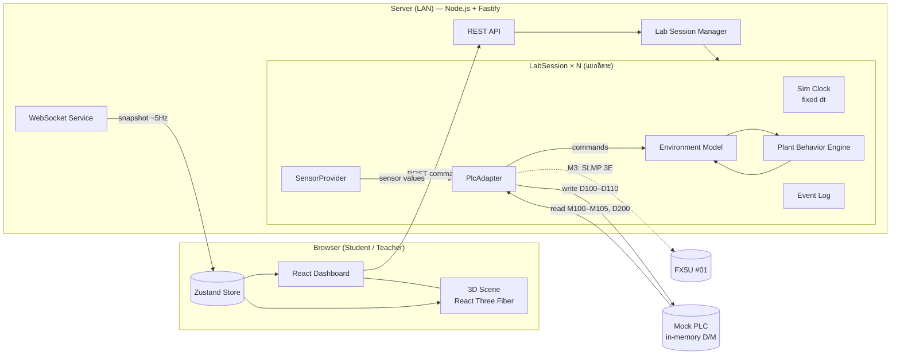
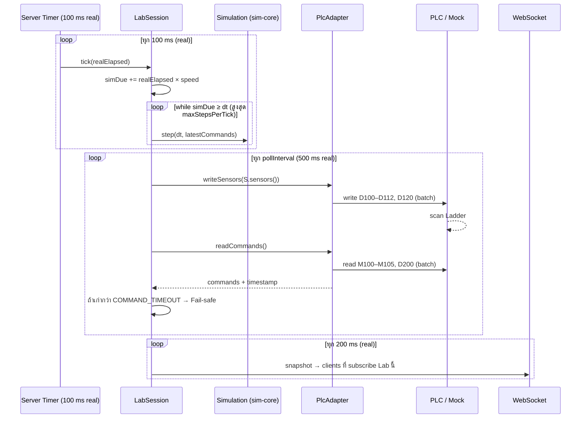

# Software Architecture

เกี่ยวข้อง: [SPEC.md](SPEC.md) · [DEVICE-MAP.md](DEVICE-MAP.md) · [PHASES.md](PHASES.md)

---

## 1. ภาพรวม



**หลักการสำคัญ**

1. **Simulation อยู่บน Server เท่านั้น** Browser มีหน้าที่แสดงผลและส่งคำสั่ง UI ส่วนผลลัพธ์จึงไม่ขึ้นกับ FPS
2. **`sim-core` เป็น Pure TypeScript** ไม่มี I/O และไม่มี `Date.now()` (เวลามาจากพารามิเตอร์) ทำให้ Deterministic และเทสต์ได้ง่าย
3. **Plant Calculation แยกจาก 3D โดยเด็ดขาด** Frontend รับ `PlantState` แล้วแปลงเป็น `PlantVisual` (droop, curl, color, scale) ผ่าน Pure Function ฝั่ง Web
4. **ทุกอย่างที่เปลี่ยนในอนาคตอยู่หลัง Interface** ได้แก่ `PlcAdapter` (Mock → SLMP), `SensorProvider` (Simulated → Real), `Persistence` (Memory → SQLite)

## 2. Repository Structure

```
Green_oak_plan/
├─ docs/                         Spec, Architecture, Device Map, Phases (Obsidian)
├─ packages/
│  ├─ shared/                    @gol/shared — ใช้ร่วม Server/Web
│  │  └─ src/
│  │     ├─ types.ts             SensorReadings, ActuatorCommands, PlantState, LabSnapshot
│  │     ├─ deviceMap.ts         Address + Scaling (single source of truth)
│  │     ├─ protocol.ts          WS/REST message schemas (zod)
│  │     └─ units.ts
│  └─ sim-core/                  @gol/sim-core — Pure simulation, no I/O
│     └─ src/
│        ├─ clock.ts             SimClock: speed, pause, accumulator, fixed dt
│        ├─ config/              defaultConfig.ts (พารามิเตอร์ + หน่วย + คำอธิบาย)
│        ├─ environment/         tank.ts, air.ts, light.ts, nutrient.ts, power.ts
│        ├─ plant/               plant.ts, water.ts, growth.ts, stress.ts (M2)
│        ├─ sensors.ts           State → SensorReadings (+ seeded noise)
│        ├─ simulation.ts        Simulation.step(dt, commands) — รวมทุก model
│        └─ rng.ts               Seeded PRNG
│     └─ test/                   Vitest unit tests (AC-01…AC-07)
├─ apps/
│  ├─ server/                    @gol/server — Fastify
│  │  └─ src/
│  │     ├─ index.ts             bootstrap, env
│  │     ├─ lab/                 LabSession.ts, LabManager.ts, EventLog.ts, History.ts
│  │     ├─ plc/
│  │     │  ├─ PlcAdapter.ts     interface + guards (write D sensors only)
│  │     │  ├─ MockPlcAdapter.ts in-memory device memory + auto program
│  │     │  ├─ mockPrograms.ts   ตัวอย่าง Logic แบบ Ladder (hysteresis)
│  │     │  └─ slmp/             (M3) SLMP 3E client
│  │     ├─ sensors/             SensorProvider.ts, SimulatedSensorProvider.ts
│  │     ├─ api/                 routes.ts (REST), ws.ts (WebSocket)
│  │     └─ persistence/         (M4/M5) SQLite
│  │  └─ test/                   integration tests (AC-08…AC-11)
│  └─ web/                       @gol/web — Vite + React
│     └─ src/
│        ├─ app/                 routes: /lab/:id (Student), /teacher (M4)
│        ├─ store/               labStore.ts (Zustand), wsClient.ts
│        ├─ dashboard/           Header, SensorPanel, ActuatorPanel, PlantDetail,
│        │                       Timeline, Charts, EventLog, SpeedControl
│        └─ scene/               Scene.tsx, Tank.tsx, Water.tsx, NetPots.tsx,
│                                Lettuce.tsx, Roots.tsx, Actuators/*, plantVisuals.ts
├─ .env.example
├─ package.json                  npm workspaces + scripts
└─ README.md                     ภาษาไทย (สมบูรณ์ใน P7)
```

## 3. Technology Choices

| ส่วน | เลือก | เหตุผล |
|---|---|---|
| Monorepo | **npm workspaces** | มากับ Node ไม่ต้องติดตั้งเพิ่ม เหมาะกับเครื่องห้องเรียน |
| Language | TypeScript (strict) | Type ร่วมกันระหว่าง Server/Web ผ่าน `@gol/shared` |
| Frontend | React 19, Vite, React Three Fiber 9, Drei 10, Tailwind CSS 4, Zustand 5, Recharts, Lucide React | ตาม Master Prompt (R3F 9 ต้องใช้คู่กับ React 19) |
| Backend | Fastify 5, @fastify/websocket, zod | เร็ว, Type-safe, `inject()` ทำ Integration Test ได้โดยไม่ต้องเปิดพอร์ต |
| Dev runner | `tsx` (server), Vite (web), `concurrently` | `npm run dev` คำสั่งเดียว |
| Test | **Vitest** | ใช้ได้ทั้ง sim-core, server และ web |
| Database | SQLite (`better-sqlite3`) — **เริ่ม M4/M5** | M1 ใช้ In-memory หลัง `Persistence` interface |

> เวอร์ชันจริงจะ Lock ใน `package-lock.json` ตอน P1 หากเวอร์ชันใดมีปัญหาบน Windows จะแจ้งก่อนเปลี่ยน

## 4. Runtime Loop (ต่อ 1 LabSession)



| Parameter | Default | Env |
|---|---|---|
| Fixed step `dt` | 1 s (sim) | — (`defaultConfig.ts`) |
| Server tick | 100 ms | `SIM_TICK_MS` |
| Max steps / tick | 5000 | — (ป้องกัน spiral of death) |
| PLC poll | 500 ms | `PLC_POLL_MS` |
| Command timeout | 3000 ms | `PLC_COMMAND_TIMEOUT_MS` |
| WS broadcast | 200 ms | `WS_BROADCAST_MS` |
| History sample | ทุก 10 นาทีจำลอง, เก็บ 14 วันจำลอง | — |

**Fail-safe state:** Fan OFF, Humidifier OFF, LED 0%, Refill OFF, Nutrient A/B OFF, **Air Pump ON**

## 5. Key Interfaces

```ts
// packages/shared/src/types.ts (ร่าง)
export interface ActuatorCommands {
  fan: boolean; humidifier: boolean; ledPct: number;       // 0–100
  refillPump: boolean; nutrientA: boolean; nutrientB: boolean; airPump: boolean;
}

export interface SensorReadings {
  airTempC: number; rhPct: number; ppfd: number; waterTempC: number;
  ph: number; ecMsCm: number; waterLevelPct: number; flowLpm: number;
  powerW: number; vpdKPa: number; dli: number;
}

// apps/server/src/plc/PlcAdapter.ts (ร่าง)
export interface PlcAdapter {
  readonly kind: 'mock' | 'slmp';
  connect(): Promise<void>;
  close(): Promise<void>;
  writeSensors(r: SensorReadings, sim: SimInfo): Promise<void>; // เขียน D100–D112, D120 เท่านั้น
  readCommands(): Promise<{ commands: ActuatorCommands; at: number }>;
  status(): PlcStatus;   // connected | connecting | offline | error, lastOkAt, errorCount, latencyMs
}

// apps/server/src/sensors/SensorProvider.ts (ร่าง)
export interface SensorProvider {
  readonly kind: 'simulated' | 'real';
  read(): SensorReadings;
}
```

**Write guard (FR-31):** `writeSensors` สร้าง Payload จาก `deviceMap.sensors` เท่านั้น และ Low-level writer ตรวจซ้ำว่า Device อยู่ใน Allowlist (D100–D112, D120) ถ้าไม่ใช่ให้ `throw` ส่วน M Device ไม่มี path เขียนเลย

**AI / RL hook (อนาคต):** `LabSession` มีเมธอด `observe(): LabSnapshot` และ `act(cmd: ActuatorCommands)` ซึ่งเป็นรูปแบบเดียวกับ PLC Adapter ทำให้ภายหลังเพิ่ม `AgentAdapter` ได้โดยไม่แก้ Simulation

## 6. API (M1)

**REST**

| Method | Path | ใช้ทำ |
|---|---|---|
| GET | `/api/health` | สถานะ Server |
| GET | `/api/labs` | รายการ Lab + สรุปสถานะ |
| GET | `/api/labs/:labId` | Snapshot ปัจจุบัน |
| GET | `/api/labs/:labId/history` | ข้อมูลย้อนหลังสำหรับกราฟ |
| GET | `/api/labs/:labId/events?limit=` | Event Log |
| GET | `/api/scenarios` | รายการ Scenario |
| POST | `/api/labs/:labId/commands` | ดูตารางคำสั่งด้านล่าง ตอบกลับเป็น Snapshot ใหม่ |

| Command (`type`) | Field | หมายเหตุ |
|---|---|---|
| `setSpeed` | `speed`: 1 / 60 / 360 | |
| `pause`, `resume` | — | |
| `reset` | — | เริ่มใหม่ ใช้ Scenario เดิมถ้ามี |
| `applyScenario` | `scenarioId` | Reset แล้วตั้ง Initial conditions + Disturbance |
| `clearScenario` | — | Reset แบบไม่มี Scenario |
| `setPlcMode` | `mode`: manual / auto / offline | Mock PLC เท่านั้น (409 ถ้าไม่ใช่ Mock) |
| `setManualBit` | `key`, `value` | เฉพาะ manual mode (409 ถ้าไม่ใช่) |
| `setManualLed` | `value` 0–100 | เฉพาะ manual mode |

**WebSocket** `/ws`
- Client → `{ type: "subscribe", labId }`
- Client → `{ type: "ping", t }`
- Server → `hello` (พร้อม `labIds`), `heartbeat`, `pong`, `{ type: "snapshot", labId, data: LabSnapshot }` (~5 Hz, ส่งทันทีตอน subscribe) และ `{ type: "event", labId, event }`

ทุกข้อความผ่าน zod validation ส่วน Auth/สิทธิ์ (Student เห็นเฉพาะ Lab ตัวเอง) เพิ่มใน M4

## 7. Simulation Model — M1 Baseline

> [!note] ทุกค่าใน § 7 อยู่ใน `sim-core/src/config/defaultConfig.ts` พร้อมหน่วยและคำอธิบาย
> ค่าเหล่านี้ตั้งขึ้นให้ **สมเหตุสมผลเชิงการสอน** และให้เห็นผลในเวลาเรียนเมื่อใช้ 360x ยังไม่ได้ปรับเทียบกับข้อมูลจริง

### 7.1 Tank Geometry & Water Balance

| Parameter | Value |
|---|---|
| Tank inner (L×W×H) | 50 × 40 × 20 cm → `V_max = 40 L` ที่ 100% |
| Net pot bottom height `h_pot` | 15 cm (75%) |
| Initial level | 85% |
| Refill flow `Q_refill` | 2.0 L/min |
| Evaporation (มีฝา) `E_evap` | 0.05 L/day × (VPD / 1.0 kPa) |

$$\frac{dV}{dt} = Q_{refill} + Q_{nutrient} - \sum_i U_i - E_{evap}, \qquad V \in [0, V_{max}]$$

- `U_i` = น้ำที่ต้น *i* ดูดได้จริง (ดู 7.4)
- `WaterLevel% = V / V_max × 100`, ความสูงน้ำ `h_w = level × 20 cm`

### 7.2 Light

$$PPFD_i = PPFD_{max} \cdot \frac{LED\%}{100} \cdot pos_i \qquad DLI_i \mathrel{+}= \frac{PPFD_i \cdot \Delta t}{10^6}$$

- `PPFD_max = 400 µmol/m²/s` ที่ระดับยอดพืช
- `pos_i`: ต้นกลาง = 1.00, ต้นมุม = 0.85 (ไฟส่องกลางถังมากกว่า)
- Sensor D102 = PPFD ที่ตำแหน่งกลาง (`pos = 1`)
- DLI reset ที่ 00:00 เวลาจำลอง และเก็บ `dliYesterday` ไว้แสดง

### 7.3 Air, Water Temperature, VPD

ห้องปลูกแลกเปลี่ยนอากาศกับห้องเรียน (Room) ซึ่งมีเครื่องปรับอากาศ อุณหภูมิ `T_room = 24 ± 2 °C` แกว่งตามเวลาของวัน (ร้อนสุด 15:00) และ `RH_room = 60%`

$$T_{eq} = T_{room} + \Delta T_{LED}\cdot\frac{LED\%}{100}\cdot(1 - \eta_{fan}\cdot fan) \qquad \frac{dT}{dt} = \frac{T_{eq} - T}{\tau_T}$$

- `ΔT_LED = 6 °C`, `η_fan = 0.7`, `τ_T = 20 min` → ที่ห้อง 24 °C: LED 100% และไม่เปิด Fan ≈ 30 °C (เกิน optimum), เปิด Fan ≈ 25.8 °C
- Fan ทำให้อุณหภูมิต่ำกว่า Room ไม่ได้ (สมจริง ใช้สอนข้อจำกัดของการระบายอากาศ)

$$RH_{eq} = RH_{room} + 25\cdot hum\cdot(1 - 0.6\cdot fan) + 5\cdot(1-fan) - 2.5\cdot(T - T_{room}) \qquad \frac{dRH}{dt} = \frac{RH_{eq}-RH}{\tau_{RH}}$$

- `τ_RH = 15 min`, clamp 20–98%

$$\frac{dT_w}{dt} = \frac{T - T_w}{\tau_w}, \quad \tau_w = 6\,h \qquad \text{(Refill ผสมน้ำประปา } T_{supply} = 27\,°C \text{ ตามสัดส่วนปริมาตร)}$$

$$SVP(T) = 0.6108\,e^{\frac{17.27T}{T+237.3}}\ \text{kPa}, \qquad VPD = SVP(T)\cdot\left(1-\frac{RH}{100}\right)$$

### 7.4 Plant Water — หัวใจของ M1

**Root access** สัดส่วนรากที่แช่น้ำ:

$$h_{tip} = h_{pot} - RootLength, \qquad f_{sub} = \text{clamp}\left(\frac{h_w - h_{tip}}{h_{pot} - h_{tip}}, 0, 1\right)$$

ต้นที่รากสั้น (ต้นเล็ก) จึงขาดน้ำก่อนต้นรากยาว ใช้สอนได้ว่าต้องรักษาระดับน้ำ

**Demand (Transpiration)**

$$D_i = k_T \cdot LA_i \cdot \sqrt{\frac{VPD}{1.0}} \cdot \left(0.3 + 0.7\frac{PPFD_i}{250}\right)$$

- `k_T = 3.3 L/m²/day` ทำให้ต้นเล็ก (LA ≈ 0.03 m²) ใช้ ~0.1 L/day และต้นโต (≈ 0.12 m²) ใช้ ~0.4 L/day

**Supply**

$$r_i = \min\left(1, \frac{f_{sub}}{f_{crit}}\right),\ f_{crit}=0.3 \qquad U_i = D_i \cdot r_i$$

**Hydration** `H ∈ [0, 1]`

$$\frac{dH}{dt} = -k_{loss}\,(1-r)\,\frac{D}{D_{ref}} + k_{rec}\,r\,(H_{cap} - H)$$

- `k_loss = 0.12 /h` (ตัดน้ำสนิท → H จาก 1.0 ลงเหลือ ~0.3 ใน ~6 ชม.จำลอง)
- `k_rec = 0.5 /h` (ฟื้นด้วย τ ≈ 2 ชม.)
- `H_cap = 1 − 0.5·Damage` (ต้นที่เสียหายฟื้นไม่เต็ม)

**Water Stress & Damage**

$$S_w = \text{clamp}\left(\frac{1 - H}{1 - H_{wilt}}, 0, 1\right),\ H_{wilt}=0.4 \qquad \frac{dDamage}{dt} = k_{dmg}\cdot\max(0, S_w - 0.7)$$

- `k_dmg = 0.14 /h` (S_w = 1 ต่อเนื่อง ~12 ชม. → Damage ≈ 0.5)
- **Damage ไม่มีเทอมลด** ซึ่งเป็นความเสียหายถาวรตาม FR-24

**Health Score**

$$Health = 100 \cdot (1 - Damage)\cdot(1 - 0.5\,S_w)$$

(M2 จะคูณ Light/Nutrient/Root Stress เพิ่ม)

### 7.5 Growth (M1 Baseline)

$$\frac{dB}{dt} = \mu_{max}\,B\left(1 - \frac{B}{B_{max}}\right) f_{light}\,f_{temp}\,(1-S_w)\,(1-Damage)$$

| Parameter | Value |
|---|---|
| `B₀` (fresh weight ตอนเริ่ม, Day 14) | 5 g |
| `B_max` | 150 g |
| `μ_max` | 0.25 /day |
| `f_light` | `(PPFD/(PPFD+150)) / (250/(250+150))`, clamp 0–1.2 |
| `f_temp` | Trapezoid: 0 ที่ 4 °C, 1 ที่ 15–25 °C, 0 ที่ 33 °C |

ความสัมพันธ์ที่ได้จาก Biomass:
- `LeafArea (cm²) = 10 · B`
- `LeafCount = 4 + round(1.2 · B^0.6)`
- `RootLength (cm) = 4 + 14 · (1 − e^(−B/40))`
- `GrowthStage`: Seedling (< 15 g) → Vegetative (< 100 g) → Harvest-ready

### 7.6 Nutrient (EC, pH)

**EC จาก Salt Mass Balance** (`M_s` หน่วย mS/cm·L)

$$EC = \frac{M_s}{V} \qquad \frac{dM_s}{dt} = q_{dose}\,EC_{stock}\,(A + B) + Q_{refill}\,EC_{tap} - c_{up}\sum_i U_i\cdot EC$$

- `EC_tap = 0.2`, `q_dose = 0.05 L/min`, `EC_stock = 100 mS/cm`, `c_up = 0.8` (พืชดูดเกลือช้ากว่าน้ำ ทำให้ EC ค่อย ๆ สูงขึ้นถ้าไม่เติมน้ำ)
- Initial EC = 1.2 mS/cm (ช่วงเหมาะสม Green Oak ประมาณ 0.8–1.6)
- **M1:** EC แสดงผลและส่ง PLC ได้ แต่ยังไม่มีผลต่อพืช (Nutrient Stress เพิ่มใน M2)
- A/B ratio imbalance ไม่ได้จำลองใน M1 (ระบุใน UI)

**pH (Empirical Drift)**

$$\frac{dpH}{dt} = 0.1\,/day\ (\text{drift ขึ้นจากการดูดธาตุ}) - 0.02\cdot\text{dose\_minutes} + \text{mixing กับ } pH_{tap}=7.2$$

clamp 4.0–9.0, initial 6.0 และ UI ระบุว่า **"pH model เป็นค่าประมาณเชิงประจักษ์ ปั๊ม A/B ไม่ได้ใช้ควบคุม pH"**

### 7.7 Power

| Actuator | Rated |
|---|---|
| LED Grow Light | 120 W × LED% |
| Ventilation Fan | 15 W |
| Humidifier | 25 W |
| Water Refill Pump | 18 W |
| Nutrient Pump A / B | 5 W / 5 W |
| Air Pump | 5 W |

### 7.8 Sensor Noise

Noise แบบ Gaussian ขนาดเล็ก (เช่น ±0.1 °C, ±0.5 %RH, ±0.01 pH) ใช้ **Seeded PRNG ต่อ Lab** และใส่ที่ `SensorReadings` เท่านั้น ไม่เปลี่ยน State ทำให้ Test ที่ปิด Noise ได้ผล Deterministic

### 7.9 Initial State

Sim start = **Day 14 หลังเพาะ (ย้ายลงถัง), 06:00**, LED 0%, ทุก Actuator OFF ยกเว้น Air Pump และระดับน้ำ 85%

### 7.10 Implementation Notes (P2)

รายละเอียดที่ตัดสินใจตอนเขียนโค้ด (`packages/sim-core/src/environment/`)

- **First-order response** ใช้สูตร Exact `x ← x_eq + (x − x_eq)·e^(−dt/τ)` แทน Euler จึงเสถียรทุกค่า dt และไม่ overshoot
- **น้ำไม่พอ:** ถ้า Uptake + Evaporation มากกว่าน้ำที่มี จะแบ่งน้ำตามสัดส่วนความต้องการ และ `stepEnvironment` คืนค่า `uptakeL` ที่ได้จริงให้ Plant model ใช้ (P3)
- **น้ำล้น:** ส่วนที่เกิน `V_max` ถือว่าล้นออกและพาเกลือออกไปตาม EC ปัจจุบัน
- **DLI** ใน Environment คิดที่ตำแหน่ง Sensor (`pos = 1`) ส่วน DLI รายต้นคำนวณใน Plant model ด้วย `positionFactor(i)`
- **Humidifier** ใช้น้ำจากถังแยก ไม่ลดน้ำในถังปลูก
- **Room temperature** เป็น cosine รายวัน `T_mean + A·cos(2π(h − h_peak)/24)` ร้อนสุด 15:00
- **Sensor readout** (`readSensors`) คำนวณ VPD จากค่าจริงของอากาศ (ไม่ใส่ Noise ซ้ำซ้อน) และ `readSimInfo` ให้ค่า D111/D112

### 7.11 Implementation Notes (P3)

รายละเอียดของ Plant model (`packages/sim-core/src/plant/`, `simulation.ts`)

- **ลำดับใน 1 step:** (1) แต่ละต้นคำนวณ Demand และ Root access จาก State ก่อน step → (2) `stepEnvironment` ตัดสินว่าถังจ่ายได้จริงเท่าไร → (3) แต่ละต้นอัปเดตด้วย `supplyRatio × tankFactor`
- **ผลของแสงต่อการเหี่ยว:** อัตราสูญเสีย Hydration คูณด้วย `transpirationFactor` (√VPD × แสง) ทำให้ขาดน้ำตอนแดดจัด/อากาศแห้งเหี่ยวเร็วกว่าตอนมืด (ตอนมืดใช้ 30%)
- **ระยะเวลาที่ได้ (LED 80%, ห้อง ~24 °C):** รากพ้นน้ำ → Water stress > 0.3 ใน ~1 ชม., เริ่ม Damage ~2 ชม., ขาดน้ำ 12 ชม. → Damage ≈ 0.3–0.4
- **ระดับน้ำที่ต้นกล้าเริ่มขาดน้ำ:** รากเริ่มต้น ~5.5 cm (ปลายรากที่ ~9.5 cm) ทำให้ Water stress เริ่มเมื่อระดับน้ำต่ำกว่า **~55%** และรากพ้นน้ำทั้งหมดที่ ~47% ส่วนต้นโตแล้วรากยาวกว่าจึงทนได้มากกว่า Auto program ตัวอย่างจึงเติมที่ 70%
- **การใช้น้ำจริงช้า** (~0.1–0.4 L/ต้น/วัน) ถังจึงใช้เวลาหลายวันกว่าน้ำจะลดถึงราก Scenario `water-shortage` จึงใช้ **Leak disturbance** (`disturbance.leakLph`) หรือตั้งระดับน้ำเริ่มต้นต่ำ (`setWaterLevelPct`) ไม่ใช่ Animation ที่เล่นเอง
- **ความแปรปรวนระหว่างต้น:** Biomass เริ่มต้น ±15% จาก Seeded PRNG (Deterministic ต่อ seed)
- **Events (FR-43):** `plant.water_stress` (S_w ≥ 0.3, cleared ≤ 0.15), `plant.wilting` (S_w ≥ 0.7), `plant.damage` (ข้าม 1%, 25%, 50%), `tank.roots_exposed/covered`, `tank.overflow`, `tank.empty`
- **ผลตรวจ 30 วัน (Refill 70/90, LED 80% 06–22, Fan > 25 °C):** Biomass 4.9 g (Day 14) → 110 g (Day 44, Stage harvest), ใช้น้ำ 26 L, Performance ~600k steps/s
- **ประเด็นสำหรับ M2:** pH drift ขึ้นถึง ~8.4 ใน 30 วัน เพราะไม่มี Actuator ปรับ pH ควรพิจารณาเพิ่ม pH-down pump หรือปรับ Model (แก้แล้ว: P10 Empirical equilibrium และ P22 เพิ่ม pH Down M106)
  - **แก้แล้วใน P10:** ใช้ Empirical equilibrium ตาม § 11.3 แทน drift คงที่; สูตรและผล 30 วันข้างบนเป็นประวัติ M1

## 8. Mock PLC

`MockPlcAdapter` จำลอง **Device Memory จริง** (`D[0..7999]` เป็น Int16, `M[0..7679]` เป็น bit) ทำให้ Data Path เหมือน M3 ทุกประการ คือเขียน D แบบ Scaled Integer แล้วอ่าน M/D กลับ

| Mode | พฤติกรรม |
|---|---|
| `manual` | UI ตั้งค่า M100–M105/D200 ใน Mock memory โดยตรง (แทนนักเรียนกดสวิตช์) |
| `auto` | รัน `mockPrograms.ts` ทุก Poll โดยอ่าน **D-register ที่ Scaled แล้ว** และเขียน M/D เหมือน Ladder |
| `offline` (test) | จำลองสายหลุด `readCommands()` throw เพื่อทดสอบ Fail-safe |

ตัวอย่าง Auto Program (ตรงกับ Ladder ที่นักเรียนจะเขียน):

```
Refill  : ON  ถ้า D106 < 70   | OFF ถ้า D106 ≥ 90      (hysteresis)
Fan     : ON  ถ้า D100 > 255  | OFF ถ้า D100 < 245
Humid.  : ON  ถ้า D101 < 550  | OFF ถ้า D101 > 700
LED     : D200 = 80 ระหว่าง 06:00–22:00 (ใช้ D111 Sim Time — ดู DEVICE-MAP)
Nutrient: A,B ON ถ้า D105 < 100 | OFF ถ้า D105 ≥ 120
Air pump: ON ตลอด
```

> หมายเหตุ: Mock program **ไม่ได้เขียน M Device ผ่าน Gateway** เพราะมันจำลอง "Ladder ใน PLC" และเขียน Memory ภายใน Mock เอง ส่วน Gateway ยังอ่านอย่างเดียวตาม FR-31

### 8.1 Implementation Notes (P4)

- **ไฟล์:** `apps/server/src/plc/` (PlcAdapter, DeviceMemory, MockPlcAdapter, mockPrograms, failsafe), `lab/` (LabSession, LabManager, EventLog, History), `sensors/SensorProvider.ts`, `scenarios/scenarios.ts`
- **เริ่มต้นใน Fail-safe** จนกว่าจะอ่าน Command จาก PLC สำเร็จครั้งแรก (ไม่ใช้ค่าที่ยังไม่รู้)
- **Write guard 2 ชั้น:** `encodeSensorWrite` สร้าง Payload จาก Device map เท่านั้น และเรียก `assertWritable('D', addr)` ทุก Word ก่อนเขียน ส่วน `PlcAdapter` ไม่มีเมธอดเขียน Address อิสระ
- **Manual mode** สั่งผ่าน `MockPlcAdapter.setManualBit/Led` ซึ่งเขียน Memory ภายใน "PLC" (แทนนักเรียนกดสวิตช์) ไม่ใช่ผ่าน Gateway และหลังสั่งจะ Poll ทันทีเพื่อให้ UI ตอบสนองเร็ว
- **เปลี่ยน manual ↔ auto** จะล้างคำสั่งใน PLC (คง Air Pump ไว้)
- **Event ที่ Server เพิ่ม:** `actuator.change` (พร้อม Address เช่น "Water Refill Pump (M102): ON"), `plc.commands_active`, `plc.failsafe`, `plc.comm_error`, `plc.comm_restored`, `sensor.out_of_range`, `command.out_of_range`, `sim.speed/pause/resume`, `lab.reset`, `sim.lagged` (จำกัดความถี่ 10 วินาที)
- **Lab แยกอิสระ:** แต่ละ Lab มี Simulation, Clock, Adapter, EventLog, History ของตัวเอง และใช้ seed ต่างกัน (`lab01` = seed 1) ส่วน Error ของ Lab หนึ่งในรอบ tick จะไม่หยุด Lab อื่น
- **Scenario `water-shortage`:** ระดับน้ำเริ่ม 65% + รั่ว 1.5 L/h ถ้าไม่เติม ต้นกล้าเริ่ม Water stress ภายใน ~6–8 ชั่วโมงจำลอง (~1–1.5 นาทีจริงที่ 360x)
- **ผลของการเร่งเวลา (ยืนยันจาก AC-09):** Poll ทุก 500 ms จริงที่ 360x = 3 นาทีจำลอง Refill จึงเติมได้ ~6 L (15%) ต่อรอบ ระดับน้ำจึงเกินช่วง Hysteresis ได้ ซึ่งเป็นข้อจำกัดที่ระบุใน SPEC § 7

## 9. Frontend

- **Data flow:** `wsClient` → `labStore` (Zustand) → Components และ Scene อ่านจาก Store ผ่าน selector
- **Interpolation:** Snapshot มา ~5 Hz ส่วน Scene ใช้ `useFrame` ทำ damp/lerp ไปหาค่าเป้าหมายเพื่อให้ Animation ลื่น **แต่ค่าเป้าหมายมาจาก Server เสมอ**
- **`plantVisuals(state): PlantVisual`** (Pure, มี Unit Test)
  - `droop = max(S_w, 0.8 × Damage)` → มุมก้มของใบ
  - `wilt` = droop > 0.6 → ใบห่อ/ยุบ
  - `color` = lerp(Emerald → Yellow-green → Brown) ตาม S_w และ Damage
  - `scale` ∝ ∛Biomass, `leafCount` และ `rootLength` จาก State
  - `curl` (M2 จาก Light Stress)
- **Procedural Green Oak:** Rosette ของใบ, แต่ละใบเป็น Shape ขอบหยักแบบ Oak (lobes ด้วย sine บน outline) → `ShapeGeometry` subdivided และ Deform vertex ตาม droop/curl พร้อมแยก Component ให้เปลี่ยนเป็น GLTF ภายหลังได้
- **Low Graphics Mode:** ลด segment ของใบ, ปิด shadow, `dpr = 1`, ลดจำนวนฟองอากาศ และจำค่าไว้ใน `localStorage`

### 9.1 Implementation Notes (P5)

- **โครงหน้าจอ** (`apps/web/src/app/App.tsx`): จอ ≥ 1024px เป็น Grid 3 คอลัมน์ × 2 แถว (ออกแบบที่ 1366×768) ส่วนจอแคบซ้อนแนวตั้งและเลื่อนทั้งหน้า
  - ซ้าย: Sensors → PLC (D100–D110 พร้อมจุดสีเทียบช่วงอ้างอิง) + Scenario
  - กลาง: Plant View (ตอนนี้เป็นภาพตัดขวาง 2D) + Trends + Event Log
  - ขวา: Actuators ← PLC (โหมด Mock: Auto / Manual / Offline, สวิตช์ M100–M105, LED slider D200) + Plant detail
- **Data flow:** WS `hello` → เลือก Lab (`?lab=` ใน URL) → `subscribe` → Snapshot ~5 Hz เข้า `labStore` ส่วน History ดึงทาง REST ทุก 3 วินาที และ Event รับทาง WS (โหลดย้อนหลังทาง REST ตอนเลือก Lab)
- **คำสั่ง** ส่งผ่าน `POST /commands` แล้วใช้ Snapshot ที่ตอบกลับทันที (UI ไม่ต้องรอรอบ WS)
- **ช่วงอ้างอิงของ Sensor** (`dashboard/sensorMeta.ts`) เป็นค่าเชิงการสอนสำหรับผักสลัด DWC
- **`plantVisuals()`** (`scene/plantVisuals.ts`) ใช้ทั้งภาพตัดขวาง 2D และ 3D (P6): `droop = max(S_w, 0.8·Damage)`, `wilted = droop > 0.6`, สี Emerald → Yellow-green → Brown, `scale = ∛(B/5 g)`
- **ภาพตัดขวาง 2D** วาดระดับน้ำ ก้น Net Pot และความยาวรากตามสัดส่วนจริง (1 cm = 10 หน่วย SVG) จะคงไว้เป็นมุมมองเสริมคู่กับ 3D ใน P6 เพราะเห็นความสัมพันธ์ "น้ำ vs ปลายราก" ชัดที่สุด
- **ข้อควรระวัง Zustand:** selector ห้ามคืน object/array ใหม่ทุกครั้ง (เช่น `?? []`) ให้ใช้ค่าคงที่แทน ไม่งั้น React render วนไม่รู้จบ
- **Build:** bundle ~> 500 kB (Recharts) ยอมรับได้สำหรับ LAN แต่จะพิจารณา code-split ตอนเพิ่ม 3D

### 9.2 Implementation Notes (P6)

- **ไฟล์:** `apps/web/src/scene/` — `Scene3D` (Canvas, แสงกลางวัน/กลางคืน, กล้อง), `Lettuce`, `leafGeometry`, `leafLayout`, `Tank`, `Actuators`, `Sensors`, `Clickable`, `DeviceInfo`, `SceneToolbar`, `PlantView`, `sceneStore`, `layout`, `devices`
- **หน่วยในฉาก = เมตร** ตรงกับ Config (ถัง 50×40×20 cm, ก้น Net Pot 15 cm) ระดับน้ำ, ความยาวราก และทุ่นวัดระดับน้ำจึงตรงกับ Simulation ตามสัดส่วนจริง
- **ใบ Green Oak (Procedural):** Grid ยาวตามแกน +Z ขอบหยักแบบใบโอ๊ค `w(t) = envelope(t)·(0.7 + 0.3·cos(2π·4.5·t))` และขอบเป็นคลื่น เป็น `InstancedMesh` 1 draw call ต่อต้น
- **จัดใบเป็นพุ่ม** (`leafLayout`): Golden angle, ใบนอกใหญ่และเอนต่ำ ใบในเล็กและตั้งชัน, ใบตก (droop) ลดมุมเงยของทุกใบ ใบนอกลดมากกว่า
- **Vertex shader ของใบ:** `uBend` (ปลายใบโค้งลง), `uWilt` (ใบแคบและขอบห่อลง), `uCurl` (M2 Light stress) และ `uFloorY` ทำให้ส่วนที่ตกต่ำกว่าผิวฝานอนราบบนฝา (ไม่ทะลุลงไป)
- **Animation ลื่นแต่ไม่หลอก:** ทุกค่า (droop, สี, ขนาด, ราก, ระดับน้ำ, ความเร็ว Fan, ความสว่าง LED, ฟองอากาศ, สายน้ำ Refill, หมอก Humidifier) `damp` เข้าหาค่าจาก Snapshot ของ Server ใน `useFrame` โดยอ่านผ่าน `getState()` เพื่อไม่ให้ React re-render 5 ครั้ง/วินาที
- **Interaction:** Orbit/Zoom/Pan, คลิกต้น = เลือก (ซิงก์กับ Plant panel), ดับเบิลคลิก = ซูมเข้าหาต้น, คลิกอุปกรณ์ = การ์ดข้อมูล (สถานะ + Address PLC + คำอธิบาย) และป้ายชื่อเมื่อชี้ (`Html` ของ Drei ไม่ต้องโหลดฟอนต์จาก Internet)
- **Toolbar:** 3D / 2D, Roots, Tank (Transparent → Cutaway → Opaque), Day/Night, Low, Reset camera และจำค่าไว้ใน `localStorage` (มี try/catch)
- **Low Graphics:** สร้าง Canvas ใหม่แบบไม่มี antialias, `dpr = 1`, ไม่มีเงา, ใบ 14×2 segment, ใบสูงสุด 16 ใบ, รากน้อยลง, ฟองอากาศน้อยลง, ไม่มีหมอก
- **ไม่ใช้ทรัพยากรจาก Internet** (ไม่มี HDR environment หรือฟอนต์ CDN) จึงใช้ใน LAN ที่ไม่มี Internet ได้
- **WebGL fallback:** ถ้าสร้าง 3D ไม่ได้ จะแสดงภาพตัดขวาง 2D แทนอัตโนมัติ
- **Code split:** Three.js อยู่ใน chunk `Scene3D` แยก (~255 kB gzip) โหลดเมื่อเปิดมุมมอง 3D
- **ทดสอบใน Browser (AC-13):** Scenario ขาดน้ำ + LED 80% ที่ 360x → ใบยุบนอนบนฝาเป็นสีเหลืองน้ำตาล → เติมน้ำทันเวลาภายใน ~1 นาทีจริง ใบกลับมาตั้งเป็นพุ่มสีเขียว (Stress 0.06–0.12) ส่วนต้นที่ขาดน้ำนาน (Damage ~0.48) ใบยังนอนและเป็นสีน้ำตาลหลังเติมน้ำ

## 10. Extension Points (ยังไม่ทำใน M1)

| อนาคต | จุดต่อ |
|---|---|
| SLMP / FX5U (M3) | `apps/server/src/plc/slmp/` implements `PlcAdapter` |
| 10 Lab + Teacher (M4) | `LabManager` + routes `/teacher` + Auth |
| SQLite (M4/M5) | `Persistence` interface |
| Scenario Library (M5) | `Scenario` = initial state + disturbance timeline + metrics |
| Real Sensor (Phase 2) | `RealSensorProvider` implements `SensorProvider` |
| MQTT / InfluxDB | Sink ที่ subscribe Event/Snapshot จาก `LabSession` |
| AI / RL | `observe()` / `act()` บน `LabSession` |

## 11. M2 Model Contract (P8)

ส่วนนี้แทนที่สูตร M1 เฉพาะกลไกที่ระบุเมื่อ Phase นั้นเสร็จ ค่าเป็น Educational parameters ไม่ใช่ผลวิจัยหรือเคมี/สรีรวิทยาที่ผ่านการปรับเทียบ คง Runtime fixed step 1 s และไม่ใช้เวลาจริงใน Model

### 11.1 State และลำดับ Step

| State/Input | หน่วย / ช่วง | เจ้าของ / เริ่มต้น |
|---|---|---|
| `lightStress`, `nutrientStress` | ไร้หน่วย [0,1] | PlantState / 0; ใช้ State เดิมเป็น exposure memory |
| `rootHealth` | ไร้หน่วย [0,1] | PlantState / 1; Root Stress = 1 − rootHealth ไม่เก็บค่าซ้ำ |
| `estimatedOxygen` | ไร้หน่วย [0,1] | EnvironmentState / 0.95 เมื่อมีน้ำ, 0 เมื่อถังแห้ง |
| EC / pH | mS/cm ≥0 / pH [4,9] | จาก Environment ก่อน Step ไม่มี Sensor noise |
| Hydration / Damage / Growth | ตาม M1 | Damage เพิ่มได้อย่างเดียว; รูปร่างคำนวณจาก Biomass |

ลำดับ P9–P11: (1) สร้าง PlantEnvironment จากค่าจริงก่อน Step → (2) คำนวณ Root access และ Request โดยใช้ Root Health ก่อน Step → (3) Environment จ่ายน้ำจริงและอัปเดต Salt/pH/Air/Water/Oxygen → (4) Plant อัปเดต Hydration, Light/Nutrient Stress, Root Health โดยใช้ Environment ก่อน Step และน้ำที่จ่ายจริง → (5) Growth/Morphology/DLI และ Events เดิม จากนั้นเลื่อนเวลาหนึ่ง Step

การหน่วงหนึ่ง Step ของ Root/Oxygen เป็นแบบ explicit และเหมือนกันทุกต้น; คำสั่ง Air Pump กระทบ Oxygen ใน Step นี้แล้วมีผลต่อ Root Health ใน Step ถัดไป ไม่มีวงจรคำนวณซ้ำภายใน Step; `tank.roots_exposed` ต้องดู Root access ทางเรขาคณิต ไม่ใช่ Supply ที่ลดจาก Root Health

### 11.2 Light (P9)

ให้ `C(x)=clamp(x,0,1)`, `E=C((PPFD−start)/(full−start))`, `T=C((airTemp−heatStart)/heatSpan)`

`target = C(E · (1 + heatGain·T + waterGain·(1−Hydration)))`

`S_next = target + (S−target)·exp(−dt/tau)` ใช้ tauRise เมื่อ target > S มิฉะนั้น tauRecovery; หน่วย dt/tau ต้องเป็นวินาทีตรงกัน

| Config ใน `light` | Default / ช่วงที่ใช้ได้ | เหตุผล |
|---|---|---|
| stressStartPpfd / stressFullPpfd | 350 / 650 µmol/m²/s; 0 ≤ start < full | ให้ Default LED 80% ไม่สะสม Light Stress |
| stressHeatStartC / stressHeatSpanC | 28 °C / 8 °C; span >0 | เพิ่มผลเมื่ออากาศร้อน |
| stressHeatGain / stressWaterGain | 1 / 1; ≥0 ไร้หน่วย | ความร้อน/ขาดน้ำขยาย exposure |
| stressRiseH / stressRecoveryH | 2 / 4 h; >0 | ต้องสะสมและฟื้นแบบค่อยเป็นค่อยไป |

Growth ใช้ Light factor แบบ saturating เดิม × `(1−lightStress)`; ไม่มีการหัก Hydration จาก Light Stress โดยตรง (ผลแสงต่อ Transpiration ยังเป็น M1) Low Light/Photoperiod ใช้ PPFD ตามเวลาจริงของ Simulation; DLI เป็น Diagnostic ไม่คูณ Growth ซ้ำ และไม่ประเมินวันแรกที่มีข้อมูลแค่บางวันว่าเสียหาย

### 11.3 Nutrient และ pH (P10)

Trapezoid suitability = 0 นอก [min,max], 1 ใน [optLow,optHigh], linear ระหว่างขอบ; `targetStress = 1−min(suitabilityEC, suitabilityPh)` ใช้ปัจจัยจำกัดที่แย่กว่าแทนบวก Stress สองครั้ง

| Config ใน `nutrient` | Default / ช่วงที่ใช้ได้ | เหตุผล |
|---|---|---|
| ecCardinalMsCm | [0, 0.8, 1.6, 3.2] mS/cm, เรียงเพิ่ม | ความเข้มข้นต่ำ/สูงจำกัดการโต |
| phCardinal | [4, 5.5, 6.8, 9] pH, เรียงเพิ่ม | pH ผิดช่วงลดการใช้ธาตุ |
| stressRiseH / stressRecoveryH | 6 / 12 h; >0 | Nutrient Stress สะสม/ฟื้นช้ากว่า Light |
| phEquilibrium / phTauDays | 6.2 pH / 2 day; equilibrium อยู่ [phMin,phMax], tau >0 | สภาวะดุลยภาพสมมติเพื่อการสอน แทน `phDriftPerDay` |

Stress ใช้ exponential response เช่น Light; Growth คูณ `(1−nutrientStress)`; ไม่เปลี่ยน Salt mass เพื่อดึง EC เข้าช่วงเหมาะสม และไม่จำลอง osmotic uptake แยกใน M2

pH: `p = equilibrium + (pH−equilibrium)·exp(−dt/(tauDays·86400)) − phDropPerDoseMin·doseMinutes` แล้วผสมกับ tapPh ตามปริมาตร Refill แบบเดิม และ clamp [4,9] ค่าเริ่มต้นเดิม 6 ให้ความชันเริ่มต้น 0.1 pH/day แต่ค่อยช้าลง; เป็น Empirical balance ไม่ใช่การแอบสั่งปั๊ม pH และไม่อ้างว่า pH ของจริงจะฟื้นได้เองเช่นนี้

### 11.4 Oxygen และ Root Health (P11)

`O_target = (pumpOn ? onTarget : offTarget) · C(1−max(0,Twater−tempRef)/tempSpan) · C(levelPct/minLevelPct)`

Oxygen เข้าหา target แบบ exponential ตาม tau เติมอากาศ/สูญเสีย; น้ำแห้งมี target 0 ไม่มี DO sensor ใหม่

`access = rootSupplyRatio(rootSubmerged)`; `rootTarget = min(access, C(O/healthyOxygen))`; Root Health เข้าหา target แบบ exponential ตามเวลาเสื่อม/ฟื้น

`requestSupplyRatio = access · rootHealth`; `actualSupplyRatio = requestSupplyRatio · tankFactor` และ `Uptake = Demand · actualSupplyRatio` ทำให้ไม่เกินน้ำที่ Environment จ่ายจริง ปั๊มอากาศทดแทนน้ำที่รากเข้าไม่ถึงไม่ได้

| Config ใน `root` | Default / ช่วงที่ใช้ได้ | เหตุผล |
|---|---|---|
| initialOxygen / oxygenOnTarget / oxygenOffTarget | 0.95 / 0.95 / 0.2; [0,1] | เริ่มพร้อมปลูก, เปิดปั๊มเทียบ passive aeration |
| oxygenTempRefC / oxygenTempSpanC | 24 °C / 16 °C; span >0 | น้ำร้อนลด Oxygen capacity ในแบบจำลอง |
| oxygenMinLevelPct | 10%; (0,100] | น้ำเกือบแห้งจำกัดผลของ Air Pump |
| oxygenRiseH / oxygenFallH | 2 / 2 h; >0 | ไม่เปลี่ยน Oxygen ทันทีเมื่อสั่งปั๊ม |
| healthyOxygen | 0.6; (0,1] | เหนือค่านี้ไม่จำกัด Root Health |
| healthDeclineH / healthRecoveryH | 12 / 6 h; >0 | ผลสะสมของรากและฟื้นหลังเติมอากาศ |

Root ยาวเกินก้นถัง: ความยาวรากที่ใช้คำนวณแนวดิ่งจำกัดที่ความสูงก้น Net Pot; ถ้า waterHeight ≤0 ให้ access=0 เสมอ ความยาว State ยังไม่ถูกตัด/หด (รากจริงอาจโค้งในถัง)

### 11.5 การรวมผล และ Data Contract ที่ทำต่อ (P12–P14)

- P9–P11 ต่อ Growth Light/Nutrient และ Root→Water แล้ว แต่ `damage`/`health` ยังเป็นสูตร M1 จนถึง P12 เพื่อไม่รวม Phase เกินขอบเขต
- P12 ใช้ `effectiveWaterRoot = max(waterStress, 1−rootHealth)` และ Growth factor `(1−effectiveWaterRoot)·(1−lightStress)·(1−nutrientStress)·(1−damage)` ร่วม Light/Temperature factor เดิม ไม่คูณ Root ซ้ำกับ Water; Damage driven by `max(effectiveWaterRoot, lightStress, nutrientStress)` ด้วย Threshold/rate เดิม; Health = `100·(1−damage)·(1−0.5·maxStress)`
- P13: PlantState ใช้ field เดิม; `LabSnapshot.tank.estimatedOxygen` เพิ่มจาก Environment; `HistorySample` เพิ่ม Oxygen และ `plants[]` มี id, biomassG, hydration, waterStress, lightStress, nutrientStress, rootHealth, damage, health; เวลา sample ทุก 600 s สูงสุด 2016 จุด, Event log สูงสุด 1000 รายการต่อ Lab; Reset ล้างทั้งคู่; Snapshot เป็นค่าปัจจุบัน ไม่ดัดแปลง History ด้วย Noise
- Events ใหม่ `plant.light_stress`, `plant.nutrient_stress`, `plant.root_stress` และ suffix `_cleared`: on ≥0.3/off ≤0.15, ต่อ Lab/Plant พร้อมเวลาจำลอง; ย้าย threshold ไป Config เมื่อทำ P13
- P14: Timeline เลือกต้น/ช่วง 6 h, 24 h, 14 วันจาก Server History; ข้อมูลก่อนเริ่มไม่มีให้แสดงเป็นว่าง ไม่สร้างข้อมูลย้อนหลัง; ไม่ Replay 3D/ย้อน Clock; Curl = Light Stress ผ่าน mapping, Droop ยึด Water Stress/Damage
- Test matrix: AC-16…24 แยกสาเหตุและ recovery ของแต่ละกลไก; AC-25…26 รวมหลาย Stress, Healthy 30 วัน, Time/Reset; AC-27 Data flow; AC-28 Browser; AC-29 ตรวจรับ ดู Setup และ tolerance ใน SPEC § 8.1

### 11.6 Implementation Notes (P8)

เอกสารอย่างเดียว: ยืนยันขอบเขต pH/Timeline, สูตร/หน่วย/ลำดับ Step และ AC-16…29 แล้วตามคำสั่งให้ดำเนิน P8–P11 ต่อเนื่อง; ยังไม่มีการเปลี่ยน Runtime ณ commit P8

### 11.7 Implementation Notes (P9)

- `plant/light.ts` คำนวณ target และใช้ `plant/stress.ts` สำหรับ exponential accumulation/recovery; `stepPlant` อัปเดต `lightStress` แล้วส่งเข้า Growth เท่านั้น ไม่เปลี่ยน Hydration โดยตรง
- Low Light ใช้ Light factor เดิมซึ่งทดสอบด้วย Environment คงที่; DLI ยังคงเป็น Diagnostic รายต้นและไม่ Reset Stress ตอนเที่ยงคืน
- AC-16…18 อยู่ใน `test/lightStress.test.ts`: 6 cases รวม Photoperiod 3 วันและ Simulation ตำแหน่งกลาง/มุม; tests รวม 106/106 และ typecheck ผ่าน
- Damage/Health รวมทุก Stress และ Curl ยังรอ P12/P14 ตามแผน

### 11.8 Implementation Notes (P10)

- `plant/nutrient.ts` คำนวณ suitability ของ EC/pH และสะสม Stress; `Simulation` ส่ง `envEc(env)` และ `env.ph` ก่อน Step ให้ Plant โดยตรง ไม่ผ่าน Sensor noise
- Growth คูณ Nutrient factor; Salt mass balance ไม่เปลี่ยน; ถ้า EC = 0 และไม่มีการเติมสารละลาย มวลเกลือยังเป็น 0 แม้มี Stress
- `stepPh` ใช้ `phEquilibrium`/`phTauDays` แทน `phDriftPerDay`; Test M1 ที่คาด 6.1 หลัง 1 วันเปลี่ยนเป็น 6.0786939 ตาม Contract ที่กำหนดก่อนแก้โค้ด
- AC-19…21 ใน `test/nutrientStress.test.ts` ครอบคลุม EC/pH ผิดช่วงทั้งสองด้าน, ฟื้น 48 h, Salt flows, Noise isolation และ pH 30 วันทั้งแยกกลไก/Simulation ที่ dt 1 s; tests 118/118 และ typecheck ผ่าน

### 11.9 Implementation Notes (P11)

- `environment/oxygen.ts` คำนวณ Oxygen target และ exponential response; Environment เริ่ม Oxygen 0.95 เมื่อมีน้ำ/0 เมื่อแห้ง แล้วใช้ Water Temperature และระดับน้ำหลัง Water balance ใน Step นั้น
- `plant/root.ts` ปรับ Root Health จาก Oxygen ก่อน Step และ Root access; `plantWaterRequest` คูณ Root Health ก่อนขอน้ำจากถัง และ `tankFactor` จำกัดให้ตรงปริมาณที่ถังจ่ายจริง
- `rootSubmergedFraction` จำกัดความลึกรากที่พื้นถังเพื่อไม่ให้รากยาวเข้าถึงน้ำใต้พื้นเมื่อถังแห้ง; ความยาวรากใน PlantState ยังเท่าเดิม ไม่ตัดรากสั้นลง
- แก้ `tank.roots_exposed/covered` ให้ตรวจ Root access ทางเรขาคณิต แทน Supply ratio ที่อาจลดจาก Oxygen ต่ำ ไม่ให้สอนสาเหตุผิด
- AC-22…24 อยู่ใน `test/rootStress.test.ts`: Oxygen OFF/ON, น้ำร้อน/น้ำต่ำ, Root Health และ Uptake, ถังแห้ง/รากยาว, ปริมาณที่จ่ายจริง และ Reset; tests รวม 126/126 และ typecheck ผ่าน รวม Regression เดิม
- Shared PlantState มี lightStress/nutrientStress/rootHealth อยู่แล้วจึงส่งค่าปัจจุบันผ่าน Snapshot เดิมได้; Estimated Oxygen ยังอยู่ใน Simulation Environment รอเพิ่ม LabSnapshot/History/UI ใน P13/P14 ไม่เพิ่ม PLC register
- ปรับข้อความท้าย Plant panel ให้ตรงสถานะ Model ปัจจุบัน; ไม่เปลี่ยน Visual mapping หรือเพิ่ม Dashboard controls
- **ส่งต่อ:** หยุดหลัง P11 ตามคำสั่งผู้ใช้; P12 ยังไม่เริ่ม ต้องรวม Damage/Health และตรวจ Healthy growth 30 วัน/หลาย Stress ตาม AC-25…26 ก่อนทำ Data/UI ใน P13/P14

### 11.10 Implementation Notes (P12)

- `combinedStress()` รวม Water/Root ด้วย max และให้ Growth ใช้ผลคูณกับ Light/Nutrient; Damage/Health ใช้ maximum ของทุก Stress ตาม § 11.5
- Hydration ใช้ Damage ก่อน Step แล้ว Stress ปัจจุบันสร้าง Damage ใหม่; Damage cap มีผลใน Step ถัดไป ไม่เกิดวงจรคำนวณซ้ำ
- Healthy reference 30 วันใช้ test เดียวร่วม AC-20/25; Tests ครอบคลุมหลาย Stress, Exposure 1.5/24 h ตามด้วย Recovery 48 h, และ Clock 1x/60x/360x ที่ Command schedule ตาม simulated time เดียวกันให้ Snapshot เท่ากัน
- ปรับ assertion M1 AC-04 จาก Health >95 เป็น Health ดีขึ้นจากก่อนเติม โดย Water Stress <0.1 และ Damage =0 ยังคงเดิม: Refill 24 L ลงน้ำเดิม 12 L เจือจาง EC จึงมี Nutrient Stress ที่ Health ของ M2 ต้องสะท้อน ไม่ปรับ Model ให้มองข้ามผลนี้
- Tests 131/131 และ typecheck ผ่าน; ผู้ใช้สั่งให้ดำเนินต่อ P13–P15 โดย commit แยก Phase

### 11.11 Implementation Notes (P13)

- Snapshot เพิ่ม `tank.estimatedOxygen`; History เพิ่ม Oxygen และ PlantHistorySample รายต้นทุก 600 s สูงสุด 2016 จุด เก็บค่าจริงของ Model ไม่ใช่ Sensor noise และคืนสำเนาลึก
- Stress Events Light/Nutrient/Root ใช้ threshold `cfg.events.stressOn=0.3` / `stressOff=0.15`; Damage Event levels ย้ายเข้า Config; Root Stress ใช้ `1−rootHealth`; ทดสอบหนึ่ง start/clear ต่อ Exposure และไม่ Spam
- EventLog เพิ่ม capacity เป็น 1000; `runId` เพิ่มเมื่อ clear/reset และใส่ใน Snapshot/Event พร้อม Header `X-Lab-Run-Id` ของ REST History/Events (รูปแบบ body ยังเป็น array) เพื่อให้ P14 ป้องกันข้อมูลย้อนจากรอบเก่า
- AC-27 ครอบคลุม History 15 วัน, สำเนาที่แก้ต้นฉบับไม่ได้, Lab แยก 24 h, Pause/Reset, REST/WS และ Regression PLC guard/Fail-safe; tests 139/139 และ typecheck ผ่าน

### 11.12 Implementation Notes (P14)

- Diagnostics แสดง Light/Nutrient Stress, Root Health, Estimated Oxygen พร้อมคำอธิบายไทย; Oxygen แสดง 0–100% ของดัชนี ไม่ใช่ DO mg/L
- `timeline.ts` เลือก History/Events ตามต้นและหน้าต่าง 6/24 h/14 วันสิ้นสุดที่เวลาจำลองปัจจุบัน; ข้อมูลต้นที่หายเป็น null ไม่ใช้ค่าเฉลี่ยแทน; กราฟ 6 กลุ่มรวม Biomass/Health, Stress และ Root/Oxygen
- `acceptSnapshot` ล้าง History/Events เมื่อ runId เปลี่ยนจากทุก Client; REST ตรวจ runId, viewRevision และลำดับ request ป้องกันคำตอบเก่าหลัง Reset/สลับ Lab/คำตอบกลับผิดลำดับ; Event เก็บสูงสุด 1000 เท่ากับ Server
- Mapping Curl = Light Stress และ shader ใช้ค่าที่ Server ส่งอยู่แล้ว; เพิ่ม regression ว่า PPFD อย่างเดียวไม่เปลี่ยนภาพและ Curl recovery ไม่เปลี่ยน Droop; 2D ลดความกว้างใบตาม Curl เดียวกัน
- Browser บน Windows ตรวจ 3D/Low/Roots/Cutaway, 2D, เลือกต้น, ทุกช่วงเวลา, Pause, สลับสอง Lab และ Reset จากอีกแท็บ; ตัวอย่าง Payload ขณะ Pause: Plant 3 biomass 5.105974 g → UI 5.1 g, Oxygen 0.95 → 95%, 8 history samples
- WebGL unavailable ใช้ HTML fault fixture ชั่วคราวใน dist ที่คืน null จาก WebGL getContext ก่อนโหลด bundle; fallback ทำงานและเปลี่ยน toolbar เป็น 2D, ปุ่ม 3D disabled พร้อมคำอธิบาย; แก้ layout ไม่ให้ภาพล้น
- Tests 148/148 + typecheck + build ผ่าน; Browser ปกติไม่มี console error, มี Three.js dependency deprecation warnings และ build chunk-size warning ที่ไม่ขวางการใช้งาน

### 11.13 Implementation Notes (P15)

- เพิ่ม `apps/server/test/m2Acceptance.test.ts` จำนวน 6 cases: High Light → Recovery, Initial EC 0/3.2 และ pH 4/9, Air Pump OFF 24 h → ON 24 h; ส่งคำสั่งผ่าน Mock PLC และเดิน tick/poll ด้วย FakeClock ไม่ข้าม Model steps; ทุกช่วงตรวจ History ตรง Snapshot และ Stress start/clear events
- Healthy 30 วัน, Low Light, Recovery ทัน/ช้า, Dry tank และ M1 regression ใช้ tests เดิมที่ตรวจแยกสาเหตุ; ไม่ทำซ้ำ long-run tests โดยไม่จำเป็น
- `docs/M2-ACCEPTANCE.md` ระบุคำสั่งทำซ้ำ, Setup, ระยะเวลา, Expected result และแยกข้อจำกัด Default UI จาก Controlled fixtures (เช่น Default PPFD สูงสุด 400 เทียบ fixture 650 และไม่มี pH actuator)
- Final suite: 22 files / 154 tests ผ่าน; typecheck ผ่าน; `npm run serve` build ผ่านและเปิดหน้า/REST/WS บน IP LAN ของเครื่อง Server ที่พอร์ตทดสอบ 3302, 2 Labs; ยังไม่ได้ตรวจเครื่องนักเรียนอีกเครื่อง
- Browser ทดลอง LED 100% + Air OFF แล้ว Air ON/LED 60%: ก่อนฟื้น Light Stress 26%, Root Health 65%, Oxygen 14%; หลังประมาณ 5 h จำลอง Light Stress 7%, Root Health 76%, Oxygen 62% (น้ำยังอุ่นประมาณ 28.5 °C จึงไม่คาดว่า Oxygen ต้องเป็น 95%); UI/กราฟ/Timeline ตอบสนองตาม Server
- ไม่เพิ่ม Production model parameters, PLC addresses หรือ Scenario Library ใน Phase ตรวจรับ; หยุดก่อน Visual polish, รอผู้ใช้ตรวจรับก่อน tag `m2`

### 11.14 Implementation Notes (P16 — Visual Polish)

- เพิ่ม `Greenhouse.tsx`: โครงโรงเรือนโลหะ แผงโปร่งแสง ฐานสวนและทางเดินแบบ Diorama; เปิดด้านหน้า/หลังคาด้านใกล้กล้องเพื่อเห็นผักและเลือกอุปกรณ์ได้ ไม่มี Animation ของฉากตกแต่ง
- ปรับ Leaf geometry เป็นใบกว้าง มีขอบหยักและเส้นใบจาก Vertex colors; Rosette ยกยอดอ่อนให้พุ่มมีมิติ สีเขียวอมเหลือง; ขนาดยังใช้ Biomass scale, จำนวนใบจาก Server (High cap 32 / Low cap 16), Droop/Wilt/Curl และสีเสียหายยังใช้ Mapping เดิม
- Net pot เป็นซี่โปร่งพร้อม Clay pebbles; Root geometry รวมเส้นหลัก/แขนงเป็นหนึ่ง Mesh ต่อต้น ลด Draw calls; จำกัดรากแนวดิ่งไม่ให้ทะลุก้นถังและแผ่ออกตาม Root length (ภาพเท่านั้น ไม่เปลี่ยน Root access ใน Model); Dispose geometry/material เมื่อเลิกใช้
- ฝาขาวขอบมน ถังใสสีฟ้าและน้ำโปร่งแสง; เปลี่ยนโหมดผนังแล้วสร้าง Material ใหม่ ป้องกัน Opaque ค้างเมื่อกลับ Transparent
- LED สองแถบและพัดลมสองตัวเป็นตัวแทนของ D200 และ M100 เดิมตามลำดับ ไม่เพิ่มอุปกรณ์ใน PLC หรือคูณกำลังไฟใน Simulation; จัดตำแหน่งขวด A/B ปั๊ม ท่อ และ Sensor ให้เข้ากับโรงเรือน
- ปรับแสง วัสดุ และกล้องให้เหมือนเกมปลูกผัก; Double-click focus ใช้ขนาดจาก Biomass เพื่อไม่ให้กล้องเข้าไปในพุ่มต้นโต; Low ลดรายละเอียดใบ/ราก ตัดกอหญ้าและเงาตามโหมดเดิม
- AC-30: Browser ใช้ Server fixture แยกพอร์ต 3303 ตรวจ 5 g/80 g และถังแห้ง 12 h ผ่าน Model จริง (Hydration 0%, Water stress 100%, Health 31 → ภาพเหี่ยวแบน/เหลือง); ตรวจเลือกต้น/ซูม/คืนกล้อง คลิกพัดลม High/Low/Roots/โหมดถัง/2D และไม่มี console error หลังตรวจ; ไม่แก้ State ของ Lab ผู้ใช้
- Final regression: 154/154 tests (22 files), typecheck และ production build ผ่าน; ไม่มี diff ใน sim-core, Server หรือ Shared; ยังมี chunk-size warning เดิม จึงยังไม่อ้างผล FPS บนเครื่องนักเรียน รูปลักษณ์เป็น Procedural stylized model และรอผู้ใช้ตรวจรับ

### 11.15 Implementation Notes (P17 — Game Dashboard)

- App ใช้ฉากเต็มพื้นที่ + HUD คะแนน, Water/EC/pH และต้นที่เลือก; เมนูด้านล่างเปิด native `<dialog>` ทีละแผง มี Focus trap, Escape, คืน Focus และ Scroll; Panel/Command/History เดิมยังใช้ต่อ ปรับความสูงแผงให้ Recharts วัดพื้นที่ได้จริง
- กล้องภาพรวมปรับระยะตาม Aspect ratio บนจอแคบ; HUD เรียงข้างกันบนมือถือ ไม่เพิ่มการคำนวณพืชใน Web
- `CareGame` อยู่ใน sim-core คำนวณหลังแต่ละ Fixed Step เก็บ Health × seconds ตั้งแต่ต้นรอบและ Biomass เริ่มต้นรายต้น; Snapshot ส่ง `game` พร้อม Score, Average health, Growth progress, elapsedS, deadPlantIds, status และ endedAtS; ฝั่ง Web แสดงผลเท่านั้น
- สูตรใน SPEC § 4.4; healthWeight=0.8, maxScore=1000, recordMinS=86400 อยู่ใน defaultConfig พร้อมหน่วย; การเริ่มต้นไม่มีระยะเวลาจึง 0 คะแนน (HUD แสดง —) หลัง Step แรกสภาพดีเริ่มใกล้ 800 และเพิ่มจาก Growth
- ต้น Damage ≥1 คืน Water request =0 และคง PlantState ไม่มีการฟื้น/โต; emit `plant.died` ครั้งเดียวต่อต้น และ `game.over` ครั้งเดียวเมื่อไม่มีต้นรอด; Game Over คงคะแนน/elapsed/endedAtS จน Reset แต่ยังเดิน Environment เพื่อตรวจการควบคุมได้ ไม่เขียนหรือเปลี่ยน PLC commands อัตโนมัติ
- LabSession เก็บ Best ของรอบที่จบใน Map ตาม Scenario; บันทึกรอบเก่าก่อนเปลี่ยน Scenario, Reset ไม่ล้าง Best แต่ล้าง CareGame, ทุก Snapshot คืนสำเนา; ไม่แชร์ข้าม Lab และไม่มี persistence ข้าม Server restart
- Tests เพิ่ม 6 cases: สูตร/Partial death/Defeat latch/สำเนา, Duration weighting, Permanent death, Dry vs Healthy 36 h + Events + Reset, Tick split/Pause, Eligible Best/Scenario/Lab isolation; 160/160 tests (24 files), typecheck/build ผ่าน
- Browser ตรวจ 1440×900 และ 390×844; แผงทั้ง 7, เลือก Plant 3, Manual Fan ON, กราฟที่มีข้อมูลจริง, 2D/3D, Keyboard; ถังแห้ง fixture บน Server แยก 3305 ตายครบที่ 1.17 วันและปลูกใหม่ได้ครบ 6 ต้นพร้อม Resume; Console ไม่มี error ตอนตรวจหน้าใหม่ ใช้งาน preview 3304 (Lab เดิม 3301 ไม่ถูก Reset)

### 11.16 Implementation Notes (P18 — Ventilation Fan)

- แยก `VentFan.tsx` จาก Actuators: กรอบ Extrude มุมมนเจาะช่องกลม, ใบโค้ง 5 ใบมี Pitch และขอบหนา, Motor cap, สกรูสองด้านและโครงยึดด้านหลัง; แก้ใบ Box เดิมที่อยู่ทับแกนจนเห็นเป็นก้อนกลางกรอบ
- ทั้งสองตัวอยู่ตำแหน่งเดิม ใช้ M100/Clickable เดิมและหันด้านหน้าออกนอกโรงเรือน; หมุนแกน local Z ตาม Server command ด้วยการเร่ง/ผ่อนเดิม; ลูกศรลมคงที่แสดงเฉพาะ Fan ON ไม่มีการคำนวณ Environment เพิ่ม
- Geometry ใช้ร่วมกันระหว่างใบในหนึ่งพัดลมและ Dispose เมื่อเปลี่ยน/Unmount; Low ลด curve segments โดยยังเห็นรูปทรงเดิม
- ระหว่างตรวจพบ `removeChild` error เมื่อ Canvas remount ขณะมี Html labels; คง Canvas เมื่อสลับ High/Low เพื่อรักษากล้อง/ป้าย โดย Low ยังลด DPR, เงาและรายละเอียด Geometry แต่คง antialias/WebGL power preference ของ Canvas เดิม
- Browser บน QA Server แยก 3306 ตรวจหน้า/หลัง ระยะใกล้/ไกล การคลิก M100, OFF → ON → OFF และ High/Low; หลังแก้ไม่มี console error ใหม่ในการสลับ Graphics ขณะเลือก Fan; ปิด QA Server หลังตรวจ ไม่ Reset หรือเปลี่ยน PLC ของ Lab ผู้ใช้
- `npm test` รอบแรกที่รันพร้อม Build มี 2 timeouts (5000 ms); รันแยกผ่าน 160/160 โดยไม่เปลี่ยน Test หรือ Timeout; typecheck และ production build ผ่าน (ยังมี chunk-size warning เดิม)

### 11.17 Implementation Notes (P19 — Workspace & Utility Equipment)

- Desktop ≥1100 px เปิด Sensors/Plant ทางซ้าย, Actuators ทางขวาและ Trends ขวาล่าง; Dock เป็น Toggle ของ 4 แผงและแสดง Active state, ปุ่ม Expand เปิด native Dialog เดิม; จอแคบเปิด Dialog ทีละแผง; แผงเลื่อนข้อมูลได้โดยไม่บัง Controls ของฉากทั้งหมด
- ประเภทกราฟเก็บที่ App และส่งให้ TrendChart เพื่อคง Chart/ต้นที่เลือกเมื่อขยาย ย่อหรือปิดเปิดแผง; ไม่เปลี่ยน History/คะแนน/Game Over หรือ Command API
- `UtilityEquipment.tsx`: ชุดถังสำรองฝาขาว/น้ำสีฟ้า, Pump สีดำมีครีบ Motor/ฐานยึด, Flow Sensor บนท่อสีน้ำเงิน, Air Pump ตัวถังมุมมนมีช่องระบายและขารอง, Power Meter มีปุ่ม/สายและ CanvasTexture ที่แสดง `snapshot.sensors.powerW` เป็น W; Texture/Geometry Dispose เมื่อเลิกใช้
- ย้ายอุปกรณ์ไปด้านหน้าขวาและวางมิเตอร์พ้นเสาบัง; Flow Sensor/Power Meter เดิมใน Sensors.tsx ถูกย้ายมาอยู่ในชุดเดียวกัน ไม่เพิ่ม PLC address; Reservoir เป็นภาพประกอบระดับคงที่ ไม่ได้คำนวณน้ำสำรอง
- Humidifier ตัวถังขาวยึดฐานดำมีหัวจ่ายด้านล่าง; หมอกเป็น Soft point sprites ขอบ Gaussian/fade (High 72 / Low 26) ไม่มี Asset ภายนอก; Phase ใช้ simTimeS จึงหยุดเมื่อ Pause, intensity ผ่อนตาม M101 และหายเมื่อ OFF; ใช้ Shader uniforms จาก Material จริงเพื่อให้ค่า opacity/viewport อัปเดต
- Refill stream อ่าน M102 และ waterHeightCm; Air Pump อ่าน M105 ผ่านไฟสถานะและฟองเดิมของ Tank; ข้อความ always ON ในภาพอ้างอิงไม่ถูกใช้บังคับคำสั่งใหม่
- Browser บน QA Server 3306: 1440×900, 1280×720, 390×844; เปิด/ปิด/ขยาย, Escape, Plant 3 และ Water & Stress คงหลังขยาย, กราฟมีข้อมูล, Humidifier/Refill/Air ON/OFF, Low; คลิกอุปกรณ์ตรง D107/M102/M105/D108, Meter แสดง 48 W ตรง Snapshot และหลัง Resume เปลี่ยนเป็น 25 W; ค่า Sensor ขณะ Pause ยังคงค่ารอบ Model ล่าสุดตามระบบเดิม
- ไม่มี Console error ระหว่างตรวจ; Build ยังมี chunk-size warning เดิม; ไม่แก้ sim-core, Server หรือ Shared และไม่ Reset Lab ผู้ใช้
- Final regression: 160/160 tests (24 files), typecheck และ production build ผ่าน

### 11.18 Implementation Notes (P20 — Garden Game Flow)

- `CareGame` (`sim-core/src/careGame.ts`) เป็น State machine `ready → playing → won | lost`; `step()` ไม่คิดคะแนนนอก `playing`; `canHarvest` คำนวณทุก step (รอด ≥ 1 ต้น และต้นที่รอดทุกต้น ≥ `plant.harvestAtG`); `harvest()` เพิ่ม `harvestBonus = round(game.harvestBonus × aliveFraction × averageHealth/100)` และบันทึก `yieldG`; `Simulation.startGame()/harvest()/markTestRun()` เป็น API ที่ Server เรียก และ `harvest()` ส่ง Event `game.won`
- `LabSession.enterRound()` ถูกเรียกตอนสร้างและทุก Reset/Scenario: ถ้าไม่ใช่ `autoStart` จะ `clock.pause()` รอ `startGame`; `resume` ตอบ 409 ระหว่าง `ready`/`won`; `harvest` สำเร็จแล้ว Pause และบันทึก Best ผ่าน `drainSimEvents()`
- Test run: ทุก `tick()` และตอน `startGame` ถ้า Mock PLC อยู่ `auto` → `sim.markTestRun()` (ติดถาวรจนจบรอบ); `saveRecord()` ข้ามรอบ Test
- `LabSessionOptions.autoStart` ใช้กับ Test/สคริปต์ที่ต้องการให้เวลาเดินทันที (`apps/server/test/helpers.ts` ตั้งค่าเริ่มต้นเป็น true); Server จริงเริ่มที่ `ready` เสมอ; `MOCK_PLC_MODE` ค่าเริ่มต้นเปลี่ยนเป็น `manual`
- Speed เพิ่ม 1440x/3600x (`SIM_SPEEDS`, `SPEED_VALUES`, zod) — ที่ Tick 100 ms คือ 144/360 steps ต่อ Tick ต่ำกว่า `maxStepsPerTick` 5000; ข้อจำกัด: PLC poll 500 ms = 12–30 นาทีจำลองต่อรอบ ทำให้ Refill/Nutrient แบบกดเองหยาบมากที่ Speed สูง (แนะนำลด Speed ก่อนสั่ง — จะอธิบายใน Care Guide P22)
- Web (ขั้นต่ำเพื่อให้เล่นได้ก่อน P21): ปุ่ม "เริ่มปลูก" แทน Resume ตอน `ready`, การ์ด "เก็บเกี่ยว" เมื่อ `canHarvest`, การ์ดผลชนะ, ป้าย TEST; Game Over "ปลูกใหม่" = reset + startGame; หน้า Start/Win/Guide เต็มรูปแบบอยู่ใน P21–P22

### 11.19 Implementation Notes (P21 — Levels & Missions)

- `sim-core/src/levels.ts`: `LEVELS` (ข้อมูลด่านพร้อมหน่วย), `levelRound()` → `RoundStart { initialBiomassG, startDay, mission }`; `Simulation.reset(round?)` จำ Round ไว้จนส่งค่าใหม่ (`reset({})` = Free Play) และ `startTimeS` ใช้ `startDay` ของด่าน
- `CareGame(plants, cfg, mission?)`: `targetG` แทน `harvestAtG` ทั้งใน growthProgress และ canHarvest; `step(..., powerW)` สะสม `energyKWh` จาก `powerW(cmd)` ของ Simulation; ครบ `timeLimitS` → `harvest()` ถ้าพร้อม (ส่ง `game.won`) มิฉะนั้น `lost`/`timeout` คะแนน 0; ดาว = 1 + ไม่มีต้นตาย + (สุขภาพเฉลี่ย ≥ `game.starHealthPct` และไม่เกินงบ)
- `LabSession`: `level` (null = Free Play), `unlocked`/`bestStars` ใน Memory; `saveRecord()` อัปเดตดาว/ปลดล็อกเมื่อ `won` และไม่ใช่ testRun (เรียกซ้ำได้ ผลเท่าเดิม); `recordKey` = ด่าน → Scenario → `free`; `updateCommandState()` ใส่ `applyFarmHelper()` หลังเลือกคำสั่ง PLC (ไม่ใช้ตอน Fail-safe) — คำสั่งใน Snapshot จึงเป็นคำสั่งที่ใช้จริง ไม่ใช่ค่าใน PLC สำหรับ Bit ที่ล็อก
- `LabManager` สร้าง Lab ที่ `level: 'L1'`; Test helper เดิมยังเป็น Free Play (ค่าเริ่มต้นของ LabSessionOptions)
- `deviceOfBit()` อยู่ใน `shared` ให้ Server (guard 409) และ Web (🔒) ใช้กฎเดียวกัน
- การปรับเป้า: `packages/sim-core/test/levels.test.ts` เล่นตามสูตร GAME-GUIDE ทุกด่านด้วย dt 1 s (~40 s CPU รวม) และบังคับเหลือเวลา ≥ 15%; ถ้าแก้ Model พืชแล้วเทสต์นี้ล้ม ให้ปรับ `LEVELS` ไม่ใช่ลดเกณฑ์เทสต์
- (หลัง P21) Layout จอกว้าง: `scoreCards`/`sensorCard` เป็น Element ร่วม — จอแคบอยู่ใน `.garden-hud`, จอกว้างอยู่ใน `.workspace-left` (flex column เริ่ม top 12px) ทำให้การ์ดที่สูงขึ้นดันแผงลงแทนการซ้อน; คู่มือในเกม `GuidePanel`/`LevelBriefing` อ่าน `snapshot.level` และข้อความคงที่ใน `guideContent.ts` (ไม่คำนวณพืช); Briefing แสดงครั้งเดียวต่อ `labId:runId` เมื่อ `game.status === 'ready'`
- (หลัง P21) Game Over Story: `buildLossStory(game, plants, events, history)` ใน Web เป็น Pure function อ่านเฉพาะ Event ของรอบ (`endedAtS − elapsedS … endedAtS`), History และ Stress ของต้นที่ Server คงไว้ ณ ตอนตาย (`plantCause()` = ค่าสูงสุดของ water/heat(lightStress)/nutrient/root) — ไม่คำนวณพืชซ้ำ; ข้อความปุ๋ยเลือกจาก EC ใน History ใกล้เวลานั้น (<0.8 ขาด, >1.6 เกิน, อื่น ๆ = pH)

### P26 — Green Oak Visual Refinement
- leafLayout: Rosette ใบนอก 7 cm ที่ Scale 1, ใบในสั้นลง 40%, มุม 24–76 องศา, ลด Lift; จำนวนใบและ Scale ยังมาจาก plantVisuals
- leafGeometry: ขอบมนแบบ sine envelope, petiole แคบ, ruffle ขอบใบและเส้นใบ; Fragment normal จาก derivative ของผิวหลัง Bend/Wilt เพื่อให้แสงตามผิวที่เปลี่ยนรูป
- Lettuce: High 96×25 vertices ต่อใบ, Low 40×11; InstancedMesh และขีดจำกัดใบเดิม; เม็ดวัสดุปลูกมนและสีสงบ
- Scene3D ลดแสง Directional เพิ่ม Hemisphere; App เริ่มแผง Actuators เท่านั้น และขยายความสูงแผงเมื่อปิด Trends ส่วนแผงอื่นยังเปิด/ขยายได้
- ตรวจ 186 tests, typecheck/build, Browser High/Low และ selection ผ่าน; ไม่เปลี่ยน Simulation/PLC; รอผู้ใช้ตรวจรับรูปลักษณ์

### P27 — Inline Flow Sensor
- UtilityEquipment.tsx เปลี่ยนทรง Flow Sensor เป็น RoundedBox + ฝาแปดเหลี่ยม, Union วงแหวน, คอบน/ล่างและสกรู ใช้วัสดุดำต่างเฉดเพื่อแยกชิ้นส่วน
- จุด Sensor [0.40, 0.025, 0.20] และ key flowLpm เดิม; เปลี่ยนปลายท่อจาก Pump ไปเข้าด้านซ้ายที่ x=0.357 แทนใต้ตัวเรือน

### Overflow visual (2026-10-18)
- EnvironmentState.overflowFlowLpm = stepTank.overflowL × 60 / dtS, initial/reset = 0; LabSnapshot.tank ส่งให้ Web และ mask เป็น 0 เมื่อ Refill ปิด
- Overflow.tsx แสดงหยดน้ำเล็กด้านหน้าถังเมื่อ Server รายงานอัตราล้น > 0 และปั๊มเปิด; phase ใช้ simTimeS จึงไม่เดินตอน Pause, Low ลดจาก 28 เป็น 12 หยด
- PlantView แสดงคำเตือนทั้ง 3D/2D; ไม่มีคะแนนหรือสมการน้ำใหม่ เปลี่ยนเฉพาะการเปิดเผยผลเดิมของ Model
- ตรวจ tests 187/187, typecheck/build; Lab02 พอร์ต 3308 เติมถึง 100% ได้ overflow ~2 L/min, ปิดปั๊มขณะ Pause → 0 และคำเตือนหาย; console ไม่มี error
- Preview รุ่นนี้ใช้ 3308; 3307 ยังคง Server รุ่นก่อนเพื่อไม่ล้างรอบเดิม

### 11.20 Implementation Notes (P22 — Dose Actuators & pH Down)

- **M106 `phDown`** เพิ่มใน `ActuatorCommands` / `COMMAND_BITS` (shared) → Gateway อ่าน M100–M106; Mock memory, Fail-safe (OFF), Power 5 W, Event log และ 3D (`NutrientPumps` ขวดฝาม่วงข้างขวด B) ใช้ COMMAND_BITS เดิมจึงรองรับอัตโนมัติ
- **pH Model:** `stepPh` รับ `phDownMinutes` แล้วลด `phDownPerMin × min × min(4, V_ref / V)` โดย V_ref = ปริมาตรที่ `initialLevelPct` ไม่คิดปริมาตรกรด ไม่แตะ EC; `Simulation.setPh()` สำหรับ Scenario/Event/Test
- **โดส (`LabSession`):** `doses: Map<DoseDevice, ActiveDose>`; ใน `clock.advance` แต่ละ Step ใช้ `effectiveCommands()` = คำสั่งจาก PLC/ผู้ช่วย OR Bit ของโดสที่เหลือเวลา แล้ว `consumeDoses(dt)` — โดสเริ่มที่ Step ถัดไปและจบตรงเวลาจำลอง ไม่ขึ้นกับรอบ Poll; ไม่เขียน Mock memory จึงไม่ต้องรอ Poll เพื่อปิด
- `commands` ใน Snapshot และ `overflowFlowLpm` ใช้ค่าหลังรวมโดส; Event `dose.start` / `dose.done` / `dose.cancel`
- **ยกเลิกโดส:** `setManualBit` ของ Bit เดียวกัน, เข้า Fail-safe, `setPlcMode`, Reset/เลือกด่าน
- **ผู้ช่วยฟาร์ม:** Nutrient และ pH Down ที่ล็อก ไม่เปิดค้างตามรอบ Poll อีกต่อไป (`farmHelper` ปิดไว้) แต่ `LabSession.updateCommandState` สั่ง 1 โดสเมื่อ EC < 1.0 / pH > 6.6 และไม่มีโดสชนิดนั้นค้าง — แก้ปัญหา EC พุ่งที่ 3600x
- **UI:** `ActuatorPanel` แสดงปุ่มโดส (manual และไม่ใช่ Fail-safe) พร้อม `formatDoseRemaining`, 🔒 ตามด่าน, LED presets; Slider แสดงเฉพาะ Free Play

### 11.21 Implementation Notes (P23 — Events & Challenge)

- **`sim-core/src/challenges.ts`:** `planChallenges(spec, seed, roundStartS, cfg)` ใช้ `Rng` ผสม Seed กับ `spec.salt` ของด่าน — ชนิดสุ่มลำดับแบบ Fisher–Yates (ไม่ซ้ำถ้ามีพอ), วันแบ่งช่วงเป็น n ส่วนแล้วบังคับห่าง `minGapDays`, ชั่วโมงเริ่มตามชนิด (คลื่นความร้อน 11–13 น.); `LevelDef.challenges` ส่งผ่าน `levelRound` → `RoundStart.challenges` (หรือ `challengePlan` สำหรับ Test/Fixture)
- **สถานะ:** `scheduled → warned (start − 6 h) → active → done` อัปเดตต้น `Simulation.step` และ emit `challenge.warning/start/end`; `repairLeak()` จบ leak ที่ active
- **ผลต่อ Model** (`effectsOf`): `roomTempDeltaC`/`roomRhDeltaPct` เข้า `stepAir`, `tapPh` เข้า `stepPh`, leak บวกกับ `disturbance.leakLph`, ไฟดับแทนคำสั่งด้วย OFF ทั้งหมดใน `Simulation.step`; ไม่มีเหตุการณ์ active คืน `NO_EFFECTS` คงที่ (ไม่สร้าง Object ต่อ Step)
- **ไฟดับกับโดส:** `LabSession` ถาม `sim.powerOutage` (คำนวณจากตาราง ณ เวลาก่อน Step) แล้วข้าม `consumeDoses`; Snapshot `commands` แสดง OFF ทั้งหมดระหว่างไฟดับ
- **Auto-pause:** `drainSimEvents` หยุดเมื่อ warning/start; `checkRedValues` หลังแต่ละ Tick ใช้ `sensorStatus` จาก `@gol/shared` กับ 5 ค่า หยุดครั้งแรกต่อค่าต่อรอบ (`redSeen` ล้างตอน Reset); ทำงานเฉพาะ `level !== null` และ `playing`; Resume ล้าง `reason`
- **Web:** `dashboard/ChallengeCard.tsx` (`ChallengeCard`, `AutoPauseBanner`, `AutoPauseToggle`, `challengeLine`), `formatHours`; `sensorMeta.ts` ดึงช่วงสีจาก `SENSOR_RANGES`
- **สมดุล:** วัดด้วยสูตรดูแล + การรับมือ Seed 1–5 → L3 ขยายเป็น 10 วัน; เทสต์ `levels.test.ts` ใช้สูตรเดียวกัน

### 11.22 Implementation Notes (P24 — Simple Game UI)

- **โครง:** `App.tsx` เลือก Layout ตาม `snapshot.level` — มีด่าน → `game/GameScreen` (Grid 5 ส่วน), Free Play → Layout เดิมของ P19; Dialog กลาง (Briefing, Loss, คู่มือ, คะแนน) ใช้ร่วมกัน และเพิ่ม Dialog เลือกด่าน/ผ่านด่าน (ผ่านด่านแสดงครั้งเดียวต่อ `labId:runId`)
- **`game/gameModel.ts` (Pure):** `gauges()` สีจาก `sensorStatus` ของ `@gol/shared`, อากาศใช้สีที่แย่กว่าระหว่าง Temp/RH, แสงตาม LED/PPFD/เวลา, `trendOf()` จาก History 2 จุดล่าสุด; `goalProgress()` = Biomass ต่ำสุดของต้นที่รอด ÷ เป้า; `helperMessage()` ลำดับความสำคัญตาม SPEC § 4.9 และอ้างปุ่มเฉพาะอุปกรณ์ที่ผู้เล่นคุมได้ (`canControl`)
- **แถบปุ่ม:** ส่งคำสั่งเดิม (`setManualLed`, `dose`, `setManualBit`) — ไม่มีตรรกะใหม่ฝั่ง Server; ไม่ใช่ Manual/อยู่ใน Fail-safe → แสดงเหตุผลและปุ่มเปลี่ยนเป็น Manual
- **ลิ้นชัก 🔬 (`game/ScienceDrawer.tsx`):** แท็บของคอมโพเนนต์เดิม (SensorPanel, ActuatorPanel, PlantDetail, TrendChart, EventLog, ScenarioPanel, ScoreDetail); จอกว้างเป็นแผงขวาในพื้นที่เกม จอแคบเป็น Bottom sheet
- **Server:** `levels` ใน Snapshot เป็น `LevelInfo + unlocked/bestStars` ทำให้การ์ดเลือกด่านไม่เก็บค่าเป้า/เวลา/งบซ้ำ
- **CSS:** `.game-screen` Grid areas `top / gauges+scene / helper / actions`; จอ < 1100 px เป็นคอลัมน์เดียวความสูงตามเนื้อหาและให้ `.game-main` เลื่อน

### 11.23 Implementation Notes (P24b — กลับไปใช้ Layout P19)

- `App.tsx` ไม่แยก Layout ตาม `snapshot.level` อีกแล้ว — ทุกโหมดใช้ Layout P19 (แทนที่ § 11.22 ส่วนหน้าจอ 5 ส่วน/ลิ้นชัก)
- `LevelButton` บนแถบบนเปิด Dialog `game/LevelScreens.LevelSelect` (การ์ดจาก `snapshot.levels`); `WinScreen` เด้งครั้งเดียวต่อ `labId:runId` และการ์ด "เก็บเกี่ยวสำเร็จ" ในโหมดด่านเปิดซ้ำ (`setSeenWin('')`)
- `game/HelperBubble.tsx` เรียก `helperMessage()` (Pure, มีเทสต์) แสดงเหนือ `.garden-dock` (`bottom: 112px`, จอ ≤ 900 px `106px`); ไม่แสดงใน Free Play และตอน Game Over
- `store/api.sendCommand`: เมื่อ HTTP ตอบ OK แต่ Snapshot เก่ากว่าที่ WebSocket ส่งมาแล้ว ถือว่าสำเร็จ (เดิมคืน false ทำให้ UI ที่รอผลค้าง)

### 11.24 Implementation Notes (P25 — Plant Feedback)

- **sim-core `stepPlant`:** ตอนข้ามเที่ยงคืน `gainYesterdayG = biomass − biomassDayStartG` แล้วตั้ง `biomassDayStartG` ใหม่ (จุดเดียวกับ DLI rollover); `stageChangedAtS` = เวลาจำลองหลัง Step ที่ `morphology().stage` เปลี่ยน; `Simulation.detectEvents` เก็บ `stage` ใน PlantFlags แล้ว emit `plant.stage`
- **shared `plantFeedback.ts`:** อ่าน State อย่างเดียว; สาเหตุ = Stress สูงสุด ≥ `CAUSE_STRESS_MIN` (0.25) ลำดับ น้ำ → ราก → แสง → ปุ๋ย/pH (แยก pH ด้วยช่วง ok ของ `SENSOR_RANGES`), ไม่มีแล้วกลางวัน PPFD < 50 = มืด; ป้าย "+g" และฉลองผูกกับ `minuteOfDay`/`simTimeS` (Pause = ค้าง)
- **ป้ายในฉาก (`scene/PlantBadge.tsx`):** `PlantBadges` เป็น DOM ชั้นเดียวใน `PlantView` เหนือ Canvas; แต่ละต้นลงทะเบียน Element ใน `badgeElements`; `Lettuce` คำนวณตำแหน่งจากกลุ่มเหนือทรงพุ่ม (สูงตาม scale/droop) แล้ว `project(camera)` เขียน `style.transform` ทุกเฟรม — ไม่ใช้ drei `Html` (สร้าง React root ต่อป้าย ทำให้ Error unmount/ป้ายว่างใน React 19 dev)
- Selector ของป้ายคืนสตริง `mood|cause|gain|stage|damage` (primitive) ตามกฎ Zustand; `CelebrationRing` เป็น Mesh วงแหวนทองรอบกระถาง
- **`plantVisuals`:** `leafColor(water, damage, nutrient, light)` ผสมทีละ Stress (เหลืองเขียว/เหลืองซีด/ซีดขาว/น้ำตาล), Damage ≥ 1 = น้ำตาลเข้ม; `dead` ทำให้ droop = 1 และ Lettuce เอนกลุ่มใบ 0.55 rad (damp)

### 11.25 Implementation Notes (P28 / P28b — Plant Panel)

- P28 เคยเปลี่ยนแผงต้นผักเป็นแถบ Stamina แต่ผู้ใช้ไม่ชอบ → P28b คืนแผงแบบ P25 (`dashboard/PlantDetail.tsx`)
- คงไว้: `isPlantDead` ใน `packages/shared/src/plantFeedback.ts` (Damage ≥ 1 หรือใน `deadPlantIds`) ใช้ใน `PlantDetail` และ `scene/PlantBadge.tsx` — ต้นตายไม่แสดงระยะ/สาเหตุ/โตเมื่อวาน

### 11.26 Implementation Notes (P29 — Overflow Penalty)

- `Simulation.step` ส่ง `overflowL = totalOverflowL(หลัง) − totalOverflowL(ก่อน)` และ `refillPumpW` (เมื่อบิต Refill เปิด) ให้ `CareGame.step`
- `CareGame` สะสม `overflowL`/`overflowKWh` เฉพาะ `playing`; `overflowPenalty = min(max, round(L × perL))`; `score = max(0, careScore − penalty)`; Harvest bonus บวกหลังจากนั้นตามเดิม; ดาวไม่ขึ้นกับน้ำล้น
- Web: `gameModel.helperMessage` เช็ก `tank.overflowFlowLpm > 0` ต่อจากไฟดับ/ถังรั่ว; การ์ดคะแนน, `ScoreDetail`, `WinScreen`, แถบเตือนใน `PlantView` อ่านค่าจาก `snapshot.game`

### 11.27 Implementation Notes (P30 — Photoperiod Stress)

- `plant/light.ts`: `stepLightLoad(load, ppfd, dtS, cfg)` และ `photoperiodStressTarget(load, cfg)`; `stepLightStress(..., lightLoadH)` ใช้ target = max(แสงแรงเกิน/ร้อน/ขาดน้ำ, Photoperiod) แล้วสะสม/ฟื้นด้วย time constant เดิม
- `stepPlant` อัปเดต `lightLoadH` ต่อต้นจาก PPFD ของต้นนั้น (ต้นมุมได้แสงน้อยกว่า → สะสมช้ากว่าเล็กน้อยเมื่อ PPFD < 250)
- สมดุล: LED 80 % (320/272 PPFD) สะสม 1 h/h; ตาราง 16/8 → load สูงสุด 16 แล้วมืด 8 ชม. ล้าง 24 → ไม่เกิด Stress; เปิด 24 ชม. → Stress เริ่มหลัง 18 ชม. ถึงเพดาน 0.6 ที่ 26 ชม. (ไม่ถึงเกณฑ์ Damage 0.7)
- Web: `LIGHT_LOAD_WARN_H` (16) ใน shared ใช้ใน `helperMessage` ก่อนข้อความร้อน/แห้ง

### 11.28 Implementation Notes (P31 — Level Watch HUD)

- `game/watchModel.ts` (Pure, ไม่ตั้งชื่อ `levelWatch.ts` เพราะชนกับ `LevelWatch.tsx` บน Windows): `watchDials(snapshot)` / `watchGoal(snapshot)` / `formatRemaining`; PPFD กลางคืนไฟปิด = neutral "มืด"; แสงสะสม = `max lightLoadH` ของต้นที่ยังรอด
- `game/LevelWatch.tsx`: หน้าปัด SVG (polar/arc จากด้านบน ±120°) แถบเหลือง `warn`, เขียว `ok`, เข็มตามค่า; render ใน `App.tsx` เมื่อ `snapshot.level` มีค่า
- CSS `.level-watch`: จอกว้าง `top 12 / left 262 / right 330` (ระหว่างคอลัมน์การ์ดกับแผงควบคุม), ≤ 1099 px ถัดคอลัมน์ `garden-hud`, ≤ 600 px ใต้แถวการ์ด; `.garden-stage:has(.level-watch) .autopause-banner` เลื่อนลง
- `LevelInfo.startBiomassG` ย้ายจาก `LevelDef` มาเป็นข้อมูลที่ Server ส่งใน `levels`/`level`

### 11.29 Implementation Notes (P32 — Device Rationale)

- Scenario tests `deviceRationale.test.ts` ใช้ `Simulation` จริง (dt 10 s) เทียบเปิด/ไม่เปิดด้วย Seed 5; ทดสอบเฉพาะทิศทาง/ขนาดผลตาม SPEC § 4.15 ไม่ผูกค่าตัวเลขละเอียด
- การทดสอบผลของแสงต้องเปิดพัดลม เพราะ LED 80 % เพิ่มอุณหภูมิจนความร้อนเป็นปัจจัยจำกัด (`temperatureFactor` 25–33 °C) ก่อนแสง

### 11.30 Implementation Notes (P33 — Air / VPD Stress)

- `plant/air.ts`: `dryAirStressTarget`, `humidAirStressTarget`, `stepAirStress` ใช้ `e.vpdKPa` ของ `PlantEnvironment` (VPD จากอุณหภูมิ/RH อากาศก่อน Step) และ `stepStress` (Exponential approach → ไม่ขึ้นกับ Tick)
- `combinedStress(water, light, nutrient, root, dryAir = 0, humidAir = 0)`: `waterGroup = max(water, 1 − root, dryAir)`, `nutrientGroup = max(nutrient, humidAir)`; `maximum` รวมทุกตัว → Health เห็นผล แต่ `maxStress` 0.5 < `damageStressThreshold` 0.7 จึงไม่สร้าง Damage
- เหตุผลการจัดกลุ่ม: อากาศแห้งเพิ่มการคายน้ำ/ปิดปากใบ (สาเหตุเดียวกับขาดน้ำ), อากาศชื้นจัดลดการคายน้ำที่ลำเลียงธาตุอาหาร (สาเหตุเดียวกับธาตุอาหารไม่พอ)
- Web: `airComfort` (shared) ใช้ใน `watchModel` (หน้าปัด `air`) และ `helperMessage`; `AIR_DRY_VPD`/`AIR_HUMID_VPD` ตรงกับ `cfg.airStress` ค่าเริ่ม

### 11.31 Implementation Notes (P34 — Device Rationale in UI)

- `dashboard/deviceRationale.ts`: `DEVICE_RATIONALE: Record<ActuatorKey, {problem, benefit, caution}>` + `PLAYER_DEVICE_KEY` (PlayerDevice → ActuatorKey); ใช้ใน `scene/DeviceInfo.tsx` และ `GuidePanel` แท็บ `devices` — ข้อความสอนอย่างเดียว ตรงกับ SPEC § 4.15–4.16 และ Scenario tests
- `guideContent.ts`/`gameModel.helperMessage` อัปเดตข้อความตาม Model P29–P33; ไม่เปลี่ยนโครง Layout

### 11.32 Implementation Notes (P35 — Growth Meter)

- `plant/growth.ts`: `growthEfficiency(u, cfg)` = f_light·f_temp·growthFactor·(1 − Damage); `stepBiomass` ใช้ตัวนี้ (คณิตเดิม) → `stepPlant` เก็บ `growthGPerH` = ΔB·3600/dt และ `growthEfficiency`; ต้นตาย = 0
- `CareGame`: `harvestProgress` = min ของต้นที่ Damage < 1 ของ clamp((B − B₀)/(เป้า − B₀)) — สอดคล้อง `canHarvest` (ทุกต้นที่รอดถึงเป้า)
- Web: `game/growthModel.ts` + `game/GrowthMeter.tsx`; ป้ายลอยใช้ `key={floor(simTimeS/3600)}` ให้ CSS animation เล่นใหม่เฉพาะเมื่อชั่วโมงจำลองเปลี่ยน; CSS `.growth-meter-v` วางหลัง `.workspace-right` แล้วใช้ `:has(.workspace-panel) +` เลื่อนซ้ายเมื่อเปิดแผงควบคุม

### 11.33 Implementation Notes (P36 — Sunlight)

- `environment/light.ts`: `sunPpfd(t, cfg)` ครึ่งคลื่น sine (rise → peak → set) และ `sunFraction`; `stepEnvironment` ส่ง `sunFrac` ให้ `stepAir` และบวกแดดใน PAR Sensor; `Simulation.step` ใส่ `sunPpfd` ใน `PlantEnvironment` (ไม่ระบุ = 0 เพื่อให้ Fixture เดิมใช้ได้)
- `SimInfo.sunPpfd` (optional) มาจาก `Simulation.readSimInfo()`; `SimInfoKey` จำกัดเป็น `minuteOfDay | day` เพื่อไม่เขียนแดดลง PLC
- Mock Ladder Auto: ปรับ D200 ทีละ 5 % ตาม D102 แทนค่าคงที่ 80 % (กันแสงเกินตอนแดดแรง)
- Test helpers: `NO_SUN`, `noSunConfig()`, `flatRoomConfig()` (ไม่มีแดด) สำหรับเทสต์กลไกที่ต้องการแยกผลแดด

### 11.34 Implementation Notes (P37 — Level 1 Redesign)

- `levels.ts`: L1 `lockedMode: 'off'`, `startWaterPct: 0`, `timeLimitDays: 10`, `challenges: { kinds: ['leak'], count: [2, 3], windowDays: [1, 6], leakHours: [4, 6] }`; ด่านอื่น `lockedMode: 'helper'`
- `Simulation.reset`: `startWaterPct` ตั้งปริมาตรน้ำเท่านั้น (saltMass จาก `initialLevelPct` เดิม = ปุ๋ยรองก้นถัง); `repairLeak` ซ่อมได้เฉพาะ leak ที่ `durationS === null`
- `challenges.ts`: `durationOf(..., spec)` ใช้ `leakHours`; `challengeViews` ใส่ `repairable`
- `farmHelper.ts`: พารามิเตอร์ `lockedMode`; `LabSession` ส่ง `level.lockedMode` และข้ามโดสผู้ช่วยเมื่อ 'off'
- `LabSession` Auto-pause: `redAtStart` (ข้ามค่าที่แดงตอน startGame จนกลับมาไม่แดง) + `RED_WATCH_DEVICE` (หยุดเฉพาะค่าที่ด่านให้คุมอุปกรณ์แก้)

### 11.35 Implementation Notes (P38 — Ignored Plant Factors)

- `Simulation.reset` แปลง `round.ignoredFactors` เป็น `IgnoredFactors` แล้วใส่ใน `PlantEnvironment.ignore` ทุก Step (null = นับทั้งหมด, ไม่เพิ่ม Object ในด่านปกติ)
- `stepPlant`: `plantTempC = optimalTempC(cfg)` (กลางช่วงโตเต็มที่ของ `tempCardinalC`) เมื่อไม่นับอุณหภูมิ ใช้ทั้ง Growth และ Light stress; ออกซิเจนราก `max(oxygen, healthyOxygen)`; air stress/nutrient stress = 0; `plantWaterRequest` ใช้ `referenceVpdKPa` เมื่อไม่นับอุณหภูมิ/อากาศ
- Environment จริงไม่เปลี่ยน (อุณหภูมิ, RH, EC, pH, ออกซิเจนในถัง) — ยังแสดงใน Sensor/PLC ตามเดิม
- Web: `helperMessage` ใช้ `counts(factor)` จาก `level.ignoredFactors`

### 11.36 Implementation Notes (P39 — Auto-harvest)

- `CareGame.step`: หลังคำนวณคะแนน ถ้า `canHarvest` → `harvest(plants, simTimeS)` แล้ว return (ก่อนตรวจหมดเวลา); `Simulation.step` เห็น status won → `emitWon()` ตามเดิม
- `LabSession.drainSimEvents`: Event `game.won`/`game.over` → `saveRecord()` + `clock.pause()`; คำสั่ง `harvest` ยังอยู่ (409 เมื่อจบแล้ว)
- ด่าน 1: `targetG: 6.8`, `timeLimitDays: 3`

### 11.37 Implementation Notes (P40 — Speed Choices)

- `SIM_SPEEDS` (sim-core) และ `SPEED_VALUES`/zod (shared) เพิ่ม 144; `UI_SPEEDS` (shared) คือปุ่มที่ `SimControls` แสดง — ความเร็วอื่นยังใช้ผ่าน API ได้
- ที่ Tick 100 ms: 144x = 14.4 Step ต่อ Tick (ต่ำกว่า `maxStepsPerTick` มาก)

### 11.38 Implementation Notes (P41 — Mascot Leak Prank)

- `ChallengeSpec.surprise` → `ChallengePlan.surprise`: ข้าม `warned` (scheduled → active ที่ `startS`), ผลรั่วเริ่มทันที แต่ `announce()` (Event `challenge.start` → Auto-pause ใน LabSession) รอถึง `startS + mascotExitS`; `ChallengeState.announced` คุม `challengeViews` ไม่ให้การ์ดโผล่ก่อน
- `ChallengeSpec.leakDays` (ด่าน 1): `planLeakDays` แบ่ง [fromHour, toHour) ของแต่ละวันเป็น count ช่อง สุ่มเวลาเริ่มรายนาทีให้ `start + duration + mascotExitS` อยู่ในช่องตัวเอง → ไม่ทับกัน และ Deterministic ตาม Seed เหมือนเดิม
- `mascotProgress(states, t, cfg)` คำนวณจากเวลาจำลองล้วน → Snapshot `mascot.progress`; `tank.leakLph` = `Simulation.totalLeakLph` (Scenario + เหตุการณ์) ใช้วาดน้ำหยด — `disturbance.leakLph` ยังเป็นค่า Scenario อย่างเดียวตามเดิม
- `scene/Mascot.tsx`: Sprite (`public/mascot/run.png`, `happy.png` ตัดจาก Pose Reference Sheet ด้วย Flood fill พื้นขาว) บน `Billboard` ล็อกแกน X/Z; ทางวิ่ง 3 จุดตามทางเดินหิน; ฝั่ง Web แค่ `damp` ค่าระหว่าง Snapshot (200 ms) และไม่ล้ำหน้า Server; การเด้งคำนวณจากระยะที่วิ่ง ไม่ใช่เวลาจริง จึงหยุดตาม Pause
- ไฟล์ต้นฉบับ `AP_LAB_Mascot/` (~14 MB) ไม่ได้ commit — commit เฉพาะ Sprite ที่ตัดแล้ว (~140 KB)

### 11.39 Implementation Notes (P42 — Level 1 at 720x)

- `Simulation.cfg` เป็น getter: `baseCfg` (ของ Lab) + `RoundStart.cfg` ผ่าน `mergeConfig` ตอน `reset()` — ทุกส่วน (Environment, Plant, Challenges, `LabSession.doseDurationS`) จึงเห็นค่าของรอบโดยไม่ต้องส่ง Config ใหม่; Free Play/ด่านอื่นกลับเป็น `baseCfg`
- ด่าน 1: `tank.refillFlowLpm` 0.4, `dose.refillS` 600, Mascot 2,400 s — `planLeakDays` ใช้ `mascotExitS` ของรอบ ช่องรั่ววันที่สอง (5 ชม.) ยังพอสำหรับรั่ว 3 ชม. + 40 นาที
- `LabSession.waterArmed`: ติดเมื่อน้ำ ≥ `waterPausePct`, ตกต่ำกว่า → Auto-pause แล้วปลด; ไม่ใช้ `redSeen` เพราะต้องหยุดได้ทุกครั้งที่น้ำตกลงใหม่
- `uiSpeeds(level)` ใน shared = `[1, playSpeed, 1440]`; `UI_SPEEDS` คงไว้เป็นค่าตั้งต้น

### 11.40 Implementation Notes (P43 — Level 1 Feedback)

- `LabSession.checkWaterAlert()` แยกจาก `checkRedValues()`: `waterReached` (เคยถึงเกณฑ์ในรอบ) + `waterLow` (ต่ำอยู่) → Snapshot `waterAlert` และ Event `tank.low_water` ครั้งละหนึ่งครั้งต่อการตกลงมา; ไม่ขึ้นกับ `autoPauseEnabled`
- `WaterAlertBanner` ใช้ class `.autopause-banner` เดิม (ตำแหน่งเดียวกัน) และซ่อนเมื่อแถบหยุดเกมแสดงอยู่ ไม่ให้ซ้อนกัน
- รั่วด่าน 1 รวม 18 ครั้ง/5 วัน ที่ 3 L/h — ช่อง 4 ชม. ของวันที่ 2–5 พอดีกับรั่ว 3 ชม. + Mascot ออก 40 นาที (`planLeakDays` ใช้ `mascotExitS` ของรอบ)

### 11.41 Implementation Notes (P44 — Level 2)

- `IgnoredFactors.ph`: `stepPlant` ใช้ pH กลางช่วงเหมาะของ `phCardinal` แทน pH จริงตอนคิด Nutrient stress (`nutrient` ยังปิดทั้งก้อน); `plantCause(..., { ignorePh })` ให้สาเหตุเป็น "ปุ๋ย" ไม่ใช่ "pH"
- `LabSession.checkAlerts()` รวมน้ำ + EC; `autoPauseActive` เป็นเท็จในด่านที่มี `waterAlertPct` (ไม่หยุดเกมทั้งเหตุการณ์และค่าแดง); Snapshot `alerts: string[]` — ฝั่ง Web join เป็น string ใน selector (ไม่คืน array ใหม่)
- ด่าน 2 ทับ Config ผ่าน `LevelDef.cfg` เท่านั้น: ปุ๋ยไหลช้าลง 5 เท่าและโดสยาวขึ้น 5 เท่า (EC +0.15 ต่อโดสเท่าเดิม), `phDropPerDoseMin` ÷5 ให้ pH ต่อโดสเท่าเดิม

### 11.42 Implementation Notes (P46 — Level 3)

- `ChallengeSpec.leakDays` → `days: ScheduledDay[]` (มี `kind`): `planDays` สร้างทุกรายการแล้วเรียงตามเวลาก่อนให้ `id`; รายการในวันเดียวกันต้องวางช่วงไม่ให้ Mascot ซ้อน (เทสต์ตรวจ `next.startS − mascotEnterS ≥ startS + mascotExitS`)
- `mascotState()` ใช้กับทุกชนิดที่ `surprise` → Snapshot `mascot: { progress, kind }`; `scene/Mascot.tsx` วาดของที่ถือ (🔥/🌵) เป็น `CanvasTexture` จาก Emoji ครั้งเดียว ชูเหนือหัวแล้วขยาย/จางตอน progress 0.5–0.58 (ขับด้วย progress จาก Server)
- `LabSession` แถบเตือนเป็นตาราง `RANGE_ALERTS` (EC/อุณหภูมิ/VPD) + `rangeOut` (Map) — เพิ่มค่าใหม่ได้โดยเพิ่มแถว; แสดงเฉพาะด่านที่ผู้เล่นคุมอุปกรณ์ของค่านั้น
- ไม่มีด่านที่ใช้ผู้ช่วยฟาร์มคุม pH Down แล้ว (ด่าน 1–3 `lockedMode: 'off'`, ด่าน 4 คุมเอง) — `farmHelper` ยังอยู่สำหรับด่าน 4 แบบ `helper` และ Free Play/อนาคต
- เทสต์ยาวบางข้อเพิ่ม timeout 30 s (ล้มเพราะเครื่องโหลดตอนรันทั้งชุด ไม่ใช่ผิด)

### 11.43 Implementation Notes (P47 — Developer Unlock-all)

- `npm run dev` (root) → `concurrently` → `npm run dev -w @gol/server` ทำให้ `npm_lifecycle_event = 'dev'` ใน Process ของ Server (คงอยู่แม้ `tsx watch` รีสตาร์ท) → ปลดล็อกทุกด่านโดยไม่ต้องมี `.env`; `npm start`/`serve` ได้ `'start'` จึงล็อกตามปกติ
- ปลดล็อกที่ Constructor ของ `LabSession` (Set `unlocked` ทุกด่าน) — การชนะด่านยังบันทึกดาว/Best เหมือนเดิม

### 11.44 Implementation Notes (P48 — Fan D201, Air Balance, Power Cuts)

- **M100 → D201:** `ActuatorCommands.fan` (bit) เปลี่ยนเป็น `fanPct` (0–100) — `COMMAND_BITS` เหลือ M101–M106, `FAN_COMMAND_REGISTER` D201 คู่กับ `LED_COMMAND_REGISTER` D200; `LabSession.logActuatorChanges` วน Register ทั้งสอง และ `sameCommands` ต้องรวม `fanPct` (Snapshot ไม่อัปเดตถ้าลืม)
- **Air:** `stepAir` ใช้ `f = fanPct/100` ทุกพจน์ (ระบายความร้อน, Cooling pad `−fanCoolingC·f`, ลดผลหมอก, ความชื้นสะสม) — ไม่มี Clamp "ห้ามต่ำกว่าห้อง" แล้ว; RH ที่สูงขึ้นเมื่อเย็นกว่าห้องมาจาก `rhPerDegC` เดิม (สอดคล้องกับ Cooling pad ที่ระเหยน้ำ)
- **ปุ๋ย A+B:** UI-only — `ActuatorPanel` ส่ง `setManualBit` A แล้ว B; Device map/Ladder ยังแยกได้
- **ไฟดับ:** ใช้ `powerOutage` เดิม (OUTAGE_COMMANDS) + surprise; `Mascot.tsx` เลือกทางวิ่งตาม `mascot.kind`; ด่าน 4 ใช้ `extraDays` ต่อจากเหตุการณ์สุ่ม แล้วเรียง/ให้ id ใหม่
