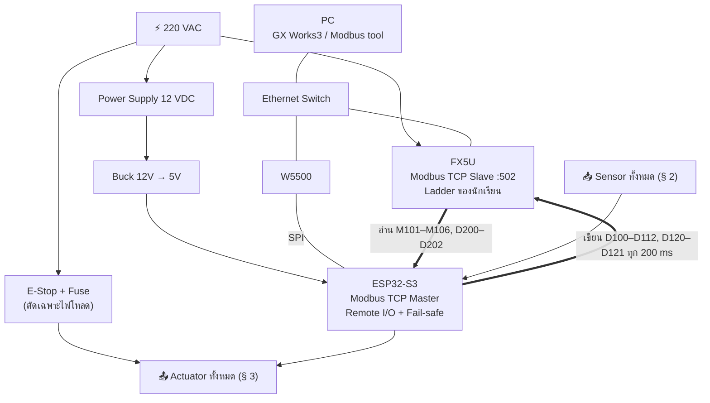
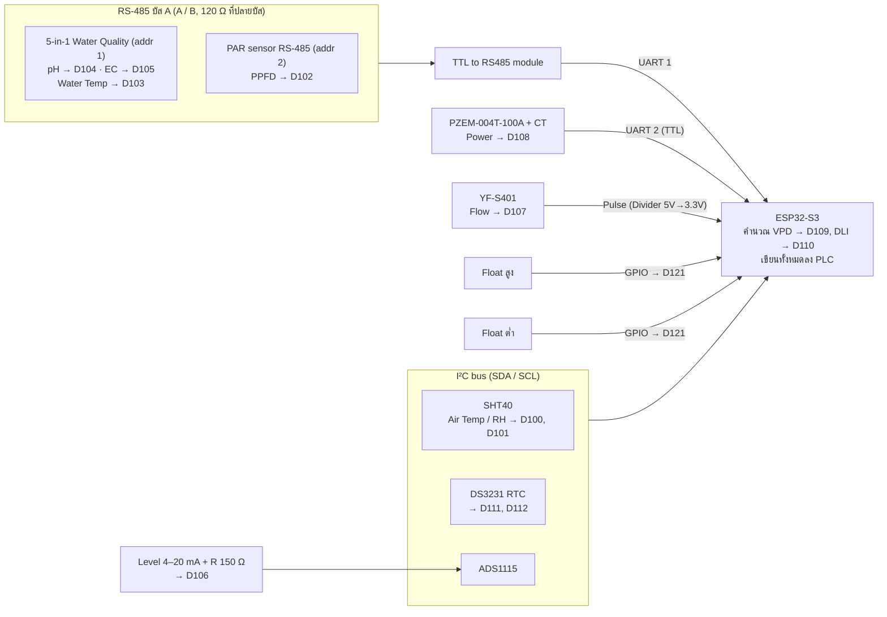
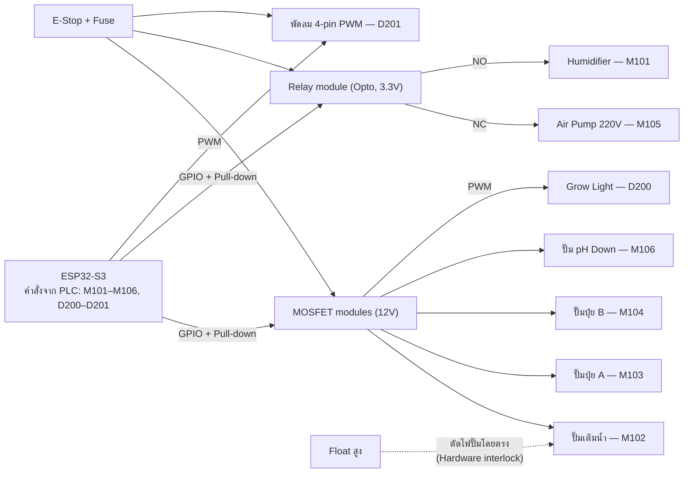
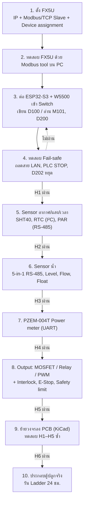

# Connection Flowchart — ต้นแบบจริง

เกี่ยวข้อง: [HARDWARE.md](HARDWARE.md) · [DEVICE-MAP.md](DEVICE-MAP.md) · ผัง § 1–3 แบบ Obsidian Canvas: [HARDWARE-FLOW.canvas](HARDWARE-FLOW.canvas)

> [!note] ผังภาพรวมการเชื่อมต่อ ยังไม่ใช่ Wiring diagram — เลขขา GPIO และรุ่นอุปกรณ์จริงจะกำหนดตอนทำ H1–H6

## 1. ภาพรวม

- เส้นหนา `==>` คือข้อมูล Modbus TCP ระหว่าง MCU กับ PLC
- E-Stop ตัดเฉพาะไฟโหลด (ปั๊ม ไฟ พัดลม) ไม่ตัดไฟ MCU และ PLC

## 2. Input — Sensor → ESP32-S3

- 5-in-1 แยกสัญญาณ pH/EC และชดเชยอุณหภูมิในตัว — ไม่ต้องใช้ Isolator และ DS18B20
- EC เต็มสเกล 2000 µS/cm: ค่า ≥ 1990 ตั้ง D121 bit 13 (เกินช่วงวัด)
- PZEM-004T เป็น TTL ไม่ใช่ RS-485 — ต่อ UART ตรง (สัญญาณ 5V ต้องลดเป็น 3.3V ก่อนเข้า RX)

## 3. Output — ESP32-S3 → Actuator

- Air Pump ต่อขา **NC** — MCU ค้าง/ไม่มีไฟ ปั๊มลมยังทำงาน
- เส้นประ: Float สูงตัดไฟปั๊มเติมน้ำโดยไม่ผ่าน Software

## 4. ลำดับการต่อและทดสอบ (ตาม Phase)

